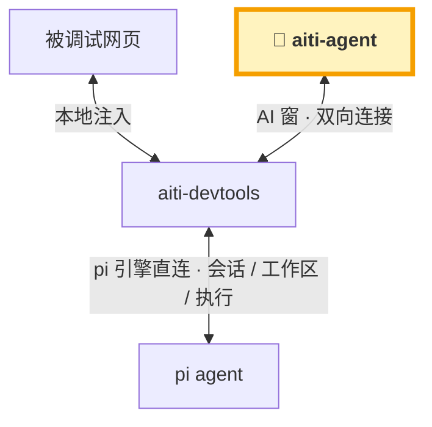
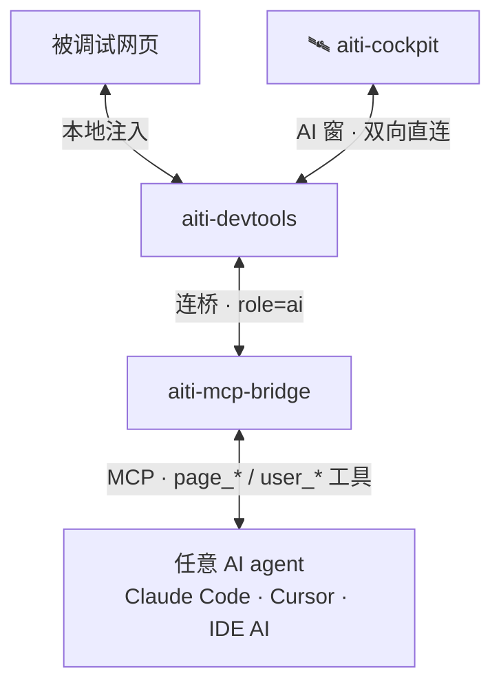

## 什么是 aiti？

**aiti**（阿嚏 ——「AI 开发像打喷嚏一样简单自然」）是一个以 **pi** 为引擎的 **AI 开发工具生态**：

- **Web 主战场**：`aiti-agent` 是自托管的个人 AI 开发工作台（基于开源项目 pi-web 构建，来历见[项目起源](/guide/origin.md)），
  浏览器是唯一操作面，Docker 一键启动，内置会话管理、服务隧道、远程调试可视化。
- **开发工具嵌入**：`aiti-devtools` 注入到 Vite / Vue / Next / React / Svelte 等主流开发工具，
  把 AI 请到页面开发现场 —— 页面就是可调试、可交互、可回答 AI 问题的对象。
- **AI agent 改造**：`aiti-mcp-bridge` 作为 MCP 桥，让 Claude Code / Cursor / IDE 内置 AI 等任意 agent
  拥有操作页面、点选元素、询问用户的能力，并把消息直接送达 IDE 的 AI agent 窗口。

### 一条链路看懂生态

两条路径，共享同一个页面现场：**aiti-agent 直连**（最佳体验）与 **MCP 代理**（回退，适配任意 agent）。

#### 最佳体验 · aiti-agent Web 控制台直连（完整 AI 控制台）

> 💡 **补充说明**：aiti-agent Web 控制台是开箱即用的默认形态；其他 AI 同样可以适配——**有 web console 的 AI，可以直接接入 aiti-devtools**（类似本图直连模式，操作页面与询问用户能力一致）。



#### 回退体验 · MCP 代理（aiti-cockpit 弱化平替）

> 💡 **补充说明**：没有 web console 的 agent，经 **aiti-mcp-bridge 走 MCP 代理**即可适配任意 agent——但 **MCP 协议的消息及时度不够**（多数 agent 靠 `aiti_inbox` 拉取，非主动推送），可能**需要不时人工干预**，体验不如直连。



### 快速体验

```bash
# 1. 在工程里装 devtools 注入（Vite 示例）
pnpm add -D @aiti-ai/aiti-devtools-vite
# 在 vite.config.ts 中启用插件，dev 启动后页面右下角出现 💬 / 🎯 按钮

# 2. 启动 MCP 桥（改造你的 AI agent）
npx @aiti-ai/aiti-mcp-bridge --http 8777

# 3. 把桥配置给任意 MCP 客户端（Claude Code / Cursor / IDE 内置 AI）
#   配置 aiti-mcp-server 后，AI 即可 page_exec / page_snapshot / user_confirm ...
```

## 产品矩阵速览

| 层 | 产品 | 包名 / 形态 | 定位 |
|---|---|---|---|
| 入口层 | aiti-agent | `@aiti-ai/aiti-agent` · Web + Docker | 自托管 AI 开发工作台（基于 pi-web） |
| 注入层 | aiti-devtools 系列 | `@aiti-ai/aiti-devtools-*` · 插件/SDK | 嵌入主流开发工具，本地注入 |
| 桥接层 | aiti-mcp-bridge | `@aiti-ai/aiti-mcp-bridge` · 本地服务 | 配置 devtools、改造 AI agent |
| Agent 层 | 任意 AI agent | Claude Code / Cursor / IDE AI | 经 MCP 操作页面、直达 IDE 窗口 |

> 完整矩阵见 [产品矩阵](/products/)，整体规划见 [路线图](/roadmaps/master-plan.md)。

### 致谢

构建于 [pi](https://pi.dev) 与 [pi-web](https://github.com/agegr/pi-web) 之上。
