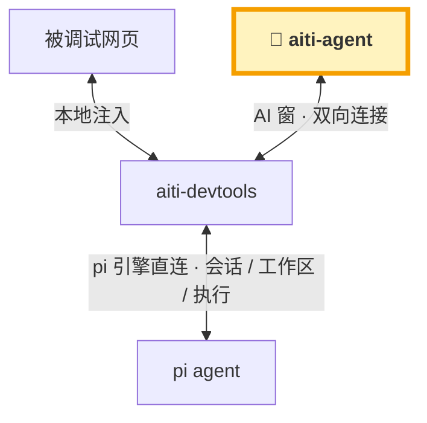
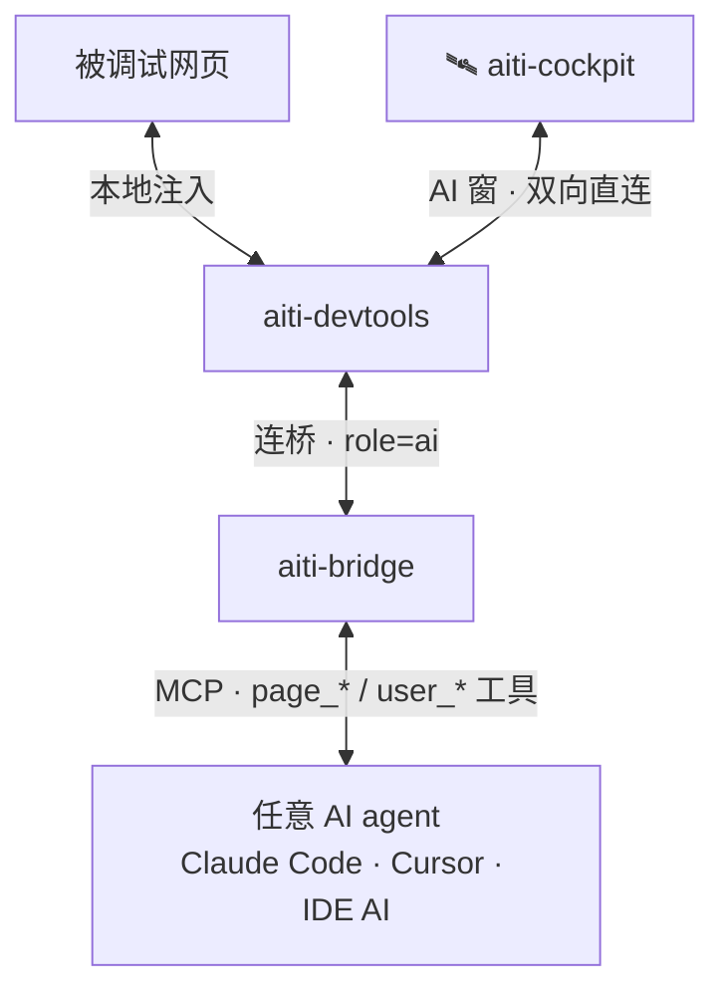

## ✨ 系统特色

> 每一条特色背后都是开箱即用的扩展——点进去看实现。

| 特色 | 一句话说明 | 对应扩展 |
| --- | --- | --- |
| 🤝 **AI 进驻网页，面对面调试** | AI 不再隔着屏幕猜页面：直接住进被调试网页，看得见、点得着、改得了，和你并肩作战 | [aiti-devtools](/extensions/aiti-devtools.md) |
| 🤖 **全程 AI Helper** | 每个扩展、每个功能都长着「AI 帮助点」：一句话生成配置、AI 回填表单、审核后落地——哪个功能都能 AI 辅助完成 | [aiti-helper](/extensions/aiti-helper.md) |
| 🌐 **端口映射 · 外部访问 · 调试注入** | 服务端口自动发现，一键暴露 http/https/tcp 隧道（TOTP 认证）；远程调试器一键注入——外部访问与调试注入，一键全解决 | [service-tunnels](/extensions/service-tunnels.md) · [aiti-debug-inject](/extensions/aiti-debug-inject.md) |
| 🖥️ **终端 · VNC · RDP，远程无忧** | 真 PTY 命令终端；无头服务器虚拟屏 + 浏览器 VNC；浏览器直连 RDP 远程桌面——没有显示器，也有舞台 | [aiti-cmd](/extensions/aiti-cmd.md) · [aiti-ui-env](/extensions/aiti-ui-env.md) |
| 📱 **全功能小屏适配** | 弹窗拖拽/缩放/持久化，小屏自动全屏；聊天与面板全面小屏优化——手机上开发从此不是梦；语音输入又快又顺，就是费电，记得配充电宝 🔋 | [aiti-float](/extensions/aiti-float.md) · [aiti-ai-input](/extensions/aiti-ai-input.md) |
| 🧙 **模型管理一条龙** | 模型添加向导（目录搜索 / 贴地址反向匹配 / 自动探测）+ 多 key 粘性轮转 + 模型聚合（组合模型，成员可配**承接类别**：图形/文本专用分工路由）+ 可用性探测（429 限流识别与恢复预测）——告别模型管理焦虑 | [aiti-model-wizard](/extensions/aiti-model-wizard.md) · [aiti-model-check](/extensions/aiti-model-check.md) |
| 🌍 **跨宿主已适配** | 除本家 aiti-agent 外，aiti-devtools 已适配 DSH（DeepSeek Harness）/ OpenClaw / OpenCode——同款页面 AI 调试体验 | [DSH 适配](/extensions/aiti-devtools-dsh.md) · [OpenClaw 适配](/extensions/aiti-devtools-openclaw.md) · [OpenCode 适配](/extensions/aiti-devtools-opencode.md) |
| 🕹️ **Java 后端直接调** | 给 AI 用的 Arthas++：JVM 内任意修改、Mock/SQL 拦截模拟、热更新 controller、诊断采样、Tunnel 桥多端点纳管，57 工具全可逆——Spring Boot / Solon 调试不必重启 | [aiti-testagent](/extensions/aiti-testagent.md) |
| 🤖🤖 **多 agent 同堂** | pi / Claude Code / Codex / Qoder / 任意 ACP agent 一个面板全看管——历史会话不是化石，点一下就复活 | [session-manager](/extensions/session-manager.md) · [claude-code](/extensions/aiti-claude-code-agent.md) · [codex](/extensions/aiti-codex-agent.md) · [qoder](/extensions/aiti-qoder-agent.md) |
| 👥 **子代理舰队** | 一句话派活：scout 侦察 / worker 干活 / reviewer 审核 / oracle 顾问，并行或流水线，Fleet 面板盯进度 | [aiti-subagents](/extensions/aiti-subagents.md) |
| 🧬 **开发血缘** | git 记录改动的内容，血缘记录改动的因果：每行代码可归因到会话、prompt、方案与操作——可评审、可回滚、可检索 | [📖 理念](/guide/lineage.md) · [评审](/extensions/aiti-git-review.md) · [方案先行](/extensions/aiti-plan-first.md) |
| 🛡️ **配置安全网** | AI/人改坏配置：有 diff 可看、一键回滚；系统崩了，命令行 watchdog 不依赖出问题的系统本身兜底恢复 | [aiti-configs](/extensions/aiti-configs.md) |
| 💬 **IM 里遥控 AI** | 钉钉/飞书/微信接入工作台——人不在电脑前，群里发句话 AI 照样干活交差 | [aiti-channels](/extensions/aiti-channels.md) |
| 🧩 **还有更多** | 消息导航、Token 用量看板、编辑器当场改码、草稿保护、prompt 收藏…… 76 个扩展一次看全 | [扩展注册表](/extensions/) |

## 什么是 aiti？

**aiti**（发音 `/aiti/`，谐音「阿嚏」——「AI 开发像打喷嚏一样简单自然」）是一个以 **pi** 为引擎的 **AI 开发工具生态**：

- **Web 主战场**：`aiti-agent` 是自托管的个人 AI 开发工作台（基于开源项目 pi-web 构建，来历见[项目起源](/guide/origin.md)），
  浏览器为主操作面，且因与 pi 同源兼容，pi CLI 与 pi IDE 扩展可操作同一批会话；Docker 一键启动，内置会话管理、服务隧道、远程调试可视化。
- **开发工具嵌入**：`aiti-devtools` 注入到 Vite / Vue / Next / React / Svelte 等主流开发工具，
  把 AI 请到页面开发现场 —— 页面就是可调试、可交互、可回答 AI 问题的对象。
- **AI agent 改造**：`aiti-bridge` 作为 MCP 桥，让 Claude Code / Cursor / IDE 内置 AI 等任意 agent
  拥有操作页面、点选元素、询问用户的能力，并把消息直接送达 IDE 的 AI agent 窗口。

### 一条链路看懂生态

两条路径，共享同一个页面现场：**aiti-agent 直连**（最佳体验）与 **MCP 代理**（回退，适配任意 agent）。

#### 最佳体验 · aiti-agent Web 控制台直连（完整 AI 控制台）

> 💡 **补充说明**：aiti-agent Web 控制台是开箱即用的默认形态；其他 AI 同样可以适配——**有 web console 的 AI，可以直接接入 aiti-devtools**（类似本图直连模式，操作页面与询问用户能力一致）。



#### 回退体验 · MCP 代理（aiti-cockpit 弱化平替）

> 💡 **补充说明**：没有 web console 的 agent，经 **aiti-bridge 走 MCP 代理**即可适配任意 agent——但 **MCP 协议的消息及时度不够**（多数 agent 靠 `aiti_inbox` 拉取，非主动推送），可能**需要不时人工干预**，体验不如直连。



#### 已适配宿主：DSH · OpenClaw · OpenCode

aiti-devtools 不锁死在本家栈里——以下第三方 agent 宿主已有完整适配（均复用同款 launcher 与 16 个 MCP 工具（page_* / user_* / aiti_* 等），端到端已验证）：

| 宿主 | 适配形态 | 亮点 |
| --- | --- | --- |
| **DSH**（DeepSeek Harness） | [`@aiti-ai/aiti-devtools-dsh`](/extensions/aiti-devtools-dsh.md) · Cordis 插件 | 进程内桥挂 `/aiti` 同端口 + `agent/pre-step` 占位符替换 + AI 窗候选条，官方 web UI 即 AI 窗 |
| **OpenClaw** | [`@aiti-ai/aiti-devtools-openclaw`](/extensions/aiti-devtools-openclaw.md) · 插件直连跳过 MCP | 16 工具直调桥 REST + 会话自动上线 + chat.send 消息注入 + 答复回传 + 占位符对照表 |
| **OpenCode** | [`@aiti-ai/aiti-devtools-opencode`](/extensions/aiti-devtools-opencode.md) · host 插件 | 16 工具进程内注册 + `messages.transform` 占位符改写；官方 web UI 即 AI 窗（反代注入，不 fork） |

### 快速体验

```bash
# 1. 在工程里装 devtools 注入（Vite 示例）
pnpm add -D @aiti-ai/aiti-devtools-vite
# 在 vite.config.ts 中启用插件，dev 启动后页面右下角出现 💬 / 🎯 按钮

# 2. 启动 MCP 桥（改造你的 AI agent）
npx @aiti-ai/aiti-bridge --port 8777

# 3. 把桥配置给任意 MCP 客户端（Claude Code / Cursor / IDE 内置 AI）
#   配置后 AI 即可 page_exec / page_snapshot / user_confirm ...
```

## 产品矩阵速览

| 层 | 产品 | 包名 / 形态 | 定位 |
|---|---|---|---|
| 入口层 | aiti-agent | `@aiti-ai/aiti-agent` · Web + Docker | 自托管 AI 开发工作台（基于 pi-web） |
| 注入层 | aiti-devtools 系列 | `@aiti-ai/aiti-devtools-*` · 插件/SDK | 嵌入主流开发工具，本地注入 |
| 桥接层 | aiti-bridge | `@aiti-ai/aiti-bridge` · 本地服务 | 配置 devtools、改造 AI agent |
| Agent 层 | 任意 AI agent | Claude Code / Cursor / IDE AI | 经 MCP 操作页面、直达 IDE 窗口 |

> 完整矩阵见 [产品矩阵](/products/)，整体规划见 [路线图](/roadmaps/master-plan.md)。

### 致谢

构建于 [pi](https://pi.dev) 与 [pi-web](https://github.com/agegr/pi-web) 之上。
