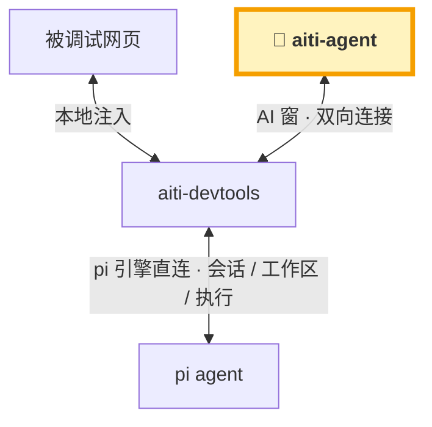
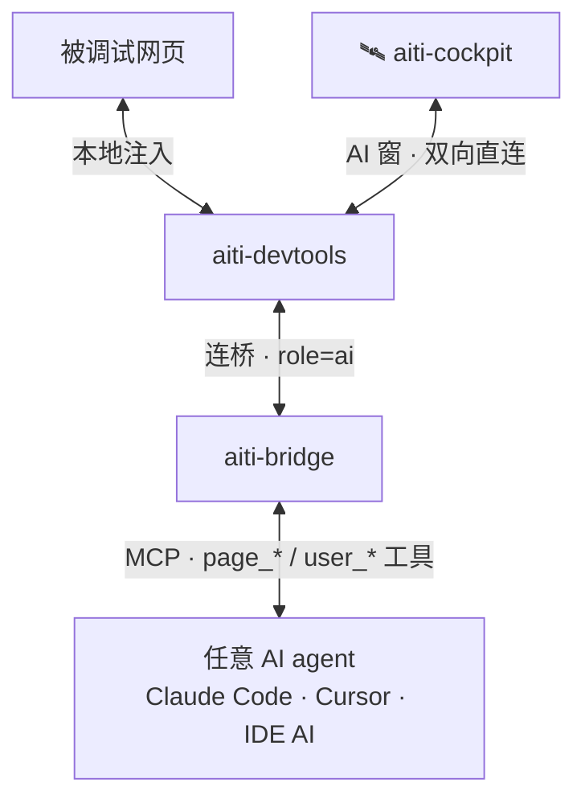

# aiti-devtools

把 AI 请到页面开发现场：注入调试客户端 + Inspector + MCP 桥，AI 和人真正在**同一个页面**上协作。

> ⚠️ **同名不同物**：[扩展注册表](/extensions/)里的 `aiti-devtools` 是 **pi-web 扩展**（pi-web 场景下的注入器/桥/MCP server 端）；本大类讲的是 npm 发布的 **SDK 与各框架插件**——它不是扩展。

## 文档地图

| 文档 | 内容 |
|---|---|
| [快速开始](quick-start.md) | 最快接入路径 |
| [SDK 本体](core.md) | SDK/资产形态（core+inject，经框架插件或独立桥分发，无独立 npm 包）：手动 script 接入 + 集成矩阵总览 |
| [注入原理](inject.md) | 本地 inject 细节、三种形态、宿主/iframe 路由 |
| [浏览器扩展](browser-ext.md) | 任意网页零改造注入（Chrome / Edge / Firefox，含 Android）|
| [CDP 命令集](cdp-commands.md) | 8 域命令参考 |
| [aiti-agent 扩展点](extension-points.md) | 扩展框架：插槽、契约、生命周期 |

## 框架集成（integrations/）

| 载体 | npm 包 | 接入方式 | 文档 | 状态 |
|---|---|---|---|---|
| Vite / SvelteKit / 任意 Vite 工程 | `@aiti-ai/aiti-devtools-vite` | `aitiDevtools()` 插件 | [vite](integrations/vite.md) | ✅ |
| webpack-dev-server | `@aiti-ai/aiti-devtools-webpack` | `new AitiDevtoolsWebpackPlugin()` | [webpack-rspack](integrations/webpack-rspack.md) | ✅ |
| Rspack | `@aiti-ai/aiti-devtools-webpack`（同一包复用） | 零改动 | [webpack-rspack](integrations/webpack-rspack.md) | ✅ 实测 |
| Nuxt | `@aiti-ai/aiti-devtools-nuxt` | `modules: ['@aiti-ai/aiti-devtools-nuxt']` 一行 | [nuxt](integrations/nuxt.md) | ✅ |
| Astro | `@aiti-ai/aiti-devtools-vite` 的 `/astro` 子导出 | `integrations: [aitiAstro()]` 一行 | [astro](integrations/astro.md) | ✅ |
| Vue 工程 | 复用 `@aiti-ai/aiti-devtools-vite` | Vite 插件兜底 | [vue](integrations/vue.md) | 📋 规划独立包 |
| Express / Next / 其他 Node 服务 | `@aiti-ai/aiti-devtools-core` | 中间件手动接线 | [manual](integrations/manual.md) | ✅ 指南 |

> npm scope 全家：`@aiti-ai/aiti-devtools-{vite,webpack,nuxt,core,inject,agent,pi}` + `@aiti-ai/aiti-bridge`——包与载体对应关系详见 [插件矩阵](/products/aiti-devtools-plugins.md)。

## 示例

每个载体都有最小可运行示例（统一端口段 5199-5899），见 [示例矩阵](examples.md)。

## 生态链路：两条路径，共享同一个页面现场

**aiti-agent 直连**（最佳体验）与 **MCP 代理**（回退，适配任意 agent）。

### 最佳体验 · aiti-agent Web 控制台直连（完整 AI 控制台）

> 💡 **补充说明**：aiti-agent Web 控制台是开箱即用的默认形态；其他 AI 同样可以适配——**有 web console 的 AI，可以直接接入 aiti-devtools**（类似本图直连模式，操作页面与询问用户能力一致）。



### 回退体验 · MCP 代理（aiti-cockpit 弱化平替）

> 💡 **补充说明**：没有 web console 的 agent，经 **aiti-bridge 走 MCP 代理**即可适配任意 agent——但 **MCP 协议的消息及时度不够**（多数 agent 靠 `aiti_inbox` 拉取，非主动推送），可能**需要不时人工干预**，体验不如直连。



## 已适配宿主：DSH · OpenClaw · OpenCode

aiti-devtools 不锁死在本家栈里——以下第三方 agent 宿主已有完整适配（均复用同款 launcher 与 16 个 MCP 工具（page_* / user_* / aiti_* 等），端到端已验证）：

| 宿主 | 适配形态 | 亮点 |
| --- | --- | --- |
| **DSH**（DeepSeek Harness） | [`@aiti-ai/aiti-devtools-dsh`](/extensions/aiti-devtools-dsh.md) · Cordis 插件 | 进程内桥挂 `/aiti` 同端口 + `agent/pre-step` 占位符替换 + AI 窗候选条，官方 web UI 即 AI 窗 |
| **OpenClaw** | [`@aiti-ai/aiti-devtools-openclaw`](/extensions/aiti-devtools-openclaw.md) · 插件直连跳过 MCP | 16 工具直调桥 REST + 会话自动上线 + chat.send 消息注入 + 答复回传 + 占位符对照表 |
| **OpenCode** | [`@aiti-ai/aiti-devtools-opencode`](/extensions/aiti-devtools-opencode.md) · host 插件 | 16 工具进程内注册 + `messages.transform` 占位符改写；官方 web UI 即 AI 窗（反代注入，不 fork） |

## 快速体验（5 分钟跑通「AI 操作页面」）

> 本节是 [devtools 快速开始](/devtools/quick-start.md) 的精简版（完整步骤与 Cursor/Copilot 手动配置见那页）。要装的是 **aiti Web 工作台**本身？见 [安装指南](/guide/install.md)。

```bash
# 1. 注入（Vite 示例；原生 HTML 也可直接 <script> 引入 launcher）
pnpm add -D @aiti-ai/aiti-devtools-vite      # vite.config.ts: plugins: [aitiDevtools()]

# 2. 起桥（MCP 端点内置于桥）
npx @aiti-ai/aiti-bridge --port 8777

# 3. 接入 AI agent —— Claude Code 一键注册 stdio shim（Cursor / Copilot 手动配置见快速开始页）
npx @aiti-ai/aiti-bridge --register-shim
```

dev server 起来后页面右下角出现 💬 / 🎯，对 AI 说「用 bridge_status 看看有哪些 pageId」即可开调。

## 相关

- [产品页](/products/aiti-devtools.md) · [devtools 插件矩阵](/products/aiti-devtools-plugins.md)
- [IDE 插件](/ide/)（vscode / idea，规划中）
- [MCP 桥](/guide/mcp/)
