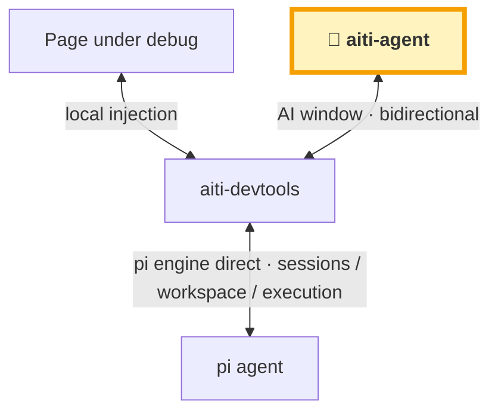
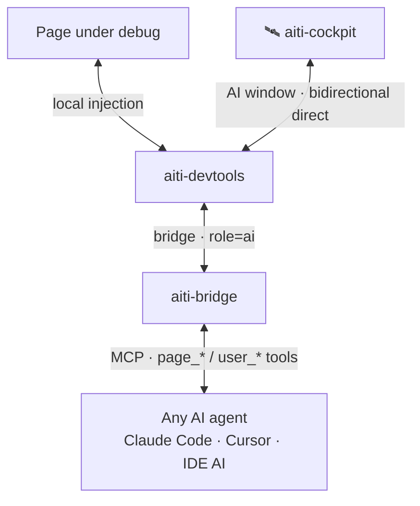

## ✨ Highlights

> Behind every highlight stands a ready-to-use extension — click through to see the implementation.

| Highlight | In one sentence | Extensions |
| --- | --- | --- |
| 🤝 **AI moves into the web page, face-to-face debugging** | The AI no longer guesses at your screen: it lives inside the page being debugged — sees it, clicks it, changes it, fights alongside you | [aiti-devtools](/en/extensions/aiti-devtools.md) |
| 🤖 **AI Helper everywhere** | Every extension, every feature grows an "AI help point": one sentence to draft config, AI fills the form, you review and commit — any feature can be AI-assisted | [aiti-helper](/en/extensions/aiti-helper.md) |
| 🌐 **Port mapping · external access · debug injection** | Service ports auto-discovered; one click to expose http/https/tcp tunnels (TOTP auth); remote debugger injected in one click — external access and debug injection, both solved at once | [service-tunnels](/en/extensions/service-tunnels.md) · [aiti-debug-inject](/en/extensions/aiti-debug-inject.md) |
| 🖥️ **Terminal · VNC · RDP, remote without worry** | Real PTY command terminal; headless virtual display + browser VNC; RDP remote desktop right in the browser — no monitor, still a stage | [aiti-cmd](/en/extensions/aiti-cmd.md) · [aiti-ui-env](/en/extensions/aiti-ui-env.md) |
| 📱 **Full small-screen support** | Dialog drag/resize/persistence, auto fullscreen on small screens; chat and panels fully mobile-optimized — development from your phone is no longer a dream; voice input is fast and smooth, just battery-hungry, keep a power bank handy 🔋 | [aiti-float](/en/extensions/aiti-float.md) · [aiti-ai-input](/en/extensions/aiti-ai-input.md) |
| 🧙 **Model management, end to end** | Model wizard (catalog search / paste-URL reverse match / auto probe) + multi-key sticky rotation + model aggregation (composite models with member **content roles**: vision/text routing) + availability probing (429 rate-limit detection & recovery prediction) — say goodbye to model-management anxiety | [aiti-model-wizard](/en/extensions/aiti-model-wizard.md) · [aiti-model-check](/en/extensions/aiti-model-check.md) |
| 🌍 **Cross-host adapters** | Beyond our own aiti-agent, aiti-devtools ships full adapters for DSH (DeepSeek Harness) / OpenClaw / OpenCode — the same in-page AI debugging experience | [DSH adapter](/en/extensions/aiti-devtools-dsh.md) · [OpenClaw adapter](/en/extensions/aiti-devtools-openclaw.md) · [OpenCode adapter](/en/extensions/aiti-devtools-opencode.md) |
| 🕹️ **Java backends, directly debugged** | Arthas++ for AI: arbitrary in-JVM changes, Mock/SQL interception, hot controller updates, diagnostic sampling, multi-endpoint bridge management, 57 reversible tools — Spring Boot / Solon debugging without restarts | [aiti-testagent](/en/extensions/aiti-testagent.md) |
| 🤖🤖 **Multi-agent, one panel** | pi / Claude Code / Codex / Qoder / any ACP agent managed in one panel — history sessions are not fossils, click and they come alive | [session-manager](/en/extensions/session-manager.md) · [claude-code](/en/extensions/aiti-claude-code-agent.md) · [codex](/en/extensions/aiti-codex-agent.md) · [qoder](/en/extensions/aiti-qoder-agent.md) |
| 👥 **Sub-agent fleet** | Delegate with one sentence: scout recon / worker execution / reviewer audit / oracle advice — parallel or pipeline, Fleet panel tracks progress | [aiti-subagents](/en/extensions/aiti-subagents.md) |
| 🧬 **Development lineage** | git records what changed; lineage records why: every line of code traceable to the session, prompt, plan and operation — reviewable, rollbackable, searchable | [📖 Concept](/en/guide/lineage.md) · [Review](/en/extensions/aiti-git-review.md) · [Plan-first](/en/extensions/aiti-plan-first.md) |
| 🛡️ **Config safety net** | AI or human breaks a config: there's a diff to inspect and one-click rollback; if the system crashes, the CLI watchdog recovers without depending on the broken system itself | [aiti-configs](/en/extensions/aiti-configs.md) |
| 💬 **Remote-control AI from IM** | DingTalk / Feishu / WeCom plugged into the workbench — away from your desk, one group message and the AI still delivers | [aiti-channels](/en/extensions/aiti-channels.md) |
| 🧩 **And more** | Message navigation, token usage dashboard, in-place code editing, draft protection, prompt bookmarks … see all 76 extensions in one place | [Extension registry](/en/extensions/) |

## What is aiti?

**aiti** (pronounced `/aiti/`, echoing a sneeze — "AI development as natural as a sneeze") is an **AI development tool ecosystem** powered by **pi**:

- **Web-first battlefield**: `aiti-agent` is a self-hosted personal AI development workbench (built on the open-source pi-web, see [project origin](/en/guide/origin.md)); the browser is the primary interface, and because it shares pi's lineage, pi CLI and pi IDE extensions operate the same sessions. One-command Docker start, with session management, service tunnels and remote-debug visualization built in.
- **Embedded in dev tools**: `aiti-devtools` injects into Vite / Vue / Next / React / Svelte and other mainstream dev tools, bringing the AI to the page development front line — the page itself becomes debuggable, interactive, and answerable.
- **AI agent retrofit**: `aiti-bridge` is an MCP bridge that gives Claude Code / Cursor / IDE built-in AI — any agent — the ability to operate pages, pick elements and ask the user, delivering messages straight to the IDE's AI agent window.

### The ecosystem in one diagram

Two paths, one shared page scene: **aiti-agent direct** (best experience) and **MCP proxy** (fallback, fits any agent).

#### Best experience · aiti-agent web console direct (full AI console)

> 💡 **Note**: the aiti-agent web console is the out-of-the-box default; other AIs can be adapted too — **AI products with a web console can plug into aiti-devtools directly** (same direct mode as the diagram, same page-operation and user-asking abilities).



#### Fallback · MCP proxy (lite alternative to aiti-cockpit)

> 💡 **Note**: agents without a web console can still be adapted via the **aiti-bridge MCP proxy** — but **MCP message timeliness is limited** (most agents poll via `aiti_inbox` rather than being pushed), so **occasional manual nudging may be needed**; the experience is not as good as direct.



#### Adapted hosts: DSH · OpenClaw · OpenCode

aiti-devtools is not locked to its own stack — these third-party agent hosts have complete adapters (all reuse the same launcher and the 16 MCP tools (page_* / user_* / aiti_* …), verified end to end):

| Host | Adapter | Highlights |
| --- | --- | --- |
| **DSH** (DeepSeek Harness) | [`@aiti-ai/aiti-devtools-dsh`](/en/extensions/aiti-devtools-dsh.md) · Cordis plugin | In-process bridge mounted at `/aiti` on one port + `agent/pre-step` placeholder rewriting + AI-window candidate bar; official web UI doubles as the AI window |
| **OpenClaw** | [`@aiti-ai/aiti-devtools-openclaw`](/en/extensions/aiti-devtools-openclaw.md) · plugin direct, skips MCP | 16 tools calling bridge REST directly + auto session online + chat.send message injection + answer relay + placeholder mapping |
| **OpenCode** | [`@aiti-ai/aiti-devtools-opencode`](/en/extensions/aiti-devtools-opencode.md) · host plugin | 16 tools registered in-process + `messages.transform` placeholder rewriting; official web UI doubles as the AI window (reverse-proxy injection, no fork) |

### Quick taste

> This is the condensed version of the [Quick start](/en/guide/quick-start.md) page (5 minutes to "AI operates your page"; full steps and the manual Cursor/Copilot config live there). Looking to install the **aiti web workbench** itself? See the [install guide](/en/guide/install.md) (npm / one-click scripts).

```bash
# 1. Inject (Vite example; plain HTML can also load the launcher via <script>)
pnpm add -D @aiti-ai/aiti-devtools-vite      # vite.config.ts: plugins: [aitiDevtools()]

# 2. Start the bridge (MCP endpoint built in)
npx @aiti-ai/aiti-bridge --port 8777

# 3. Connect an AI agent — one-line stdio shim registration for Claude Code (manual Cursor / Copilot config on the quick-start page)
npx @aiti-ai/aiti-bridge --register-shim
```

When the dev server runs, 💬 / 🎯 appear bottom-right — tell the AI "use bridge_status to list the pageIds" and start debugging.

## Product matrix at a glance

| Layer | Product | Package / form | Role |
|---|---|---|---|
| Entry | aiti-agent | `@aiti-ai/aiti-agent` · Web + Docker | Self-hosted AI dev workbench (based on pi-web) |
| Injection | aiti-devtools family | `@aiti-ai/aiti-devtools-*` · plugins/SDK | Embeds into mainstream dev tools, local injection |
| Bridge | aiti-bridge | `@aiti-ai/aiti-bridge` · local service | Configures devtools, retrofits AI agents |
| Agent | Any AI agent | Claude Code / Cursor / IDE AI | Operates pages via MCP, straight into the IDE window |

> Full matrix: [Products](/en/products/); overall plan: [master plan](/en/roadmaps/master-plan.md).

### Acknowledgements

Built on [pi](https://pi.dev) and [pi-web](https://github.com/agegr/pi-web).
