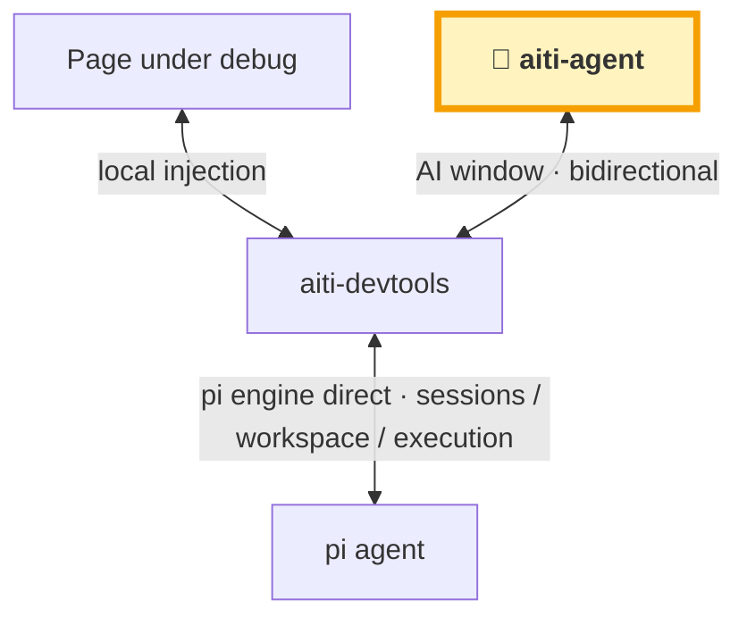
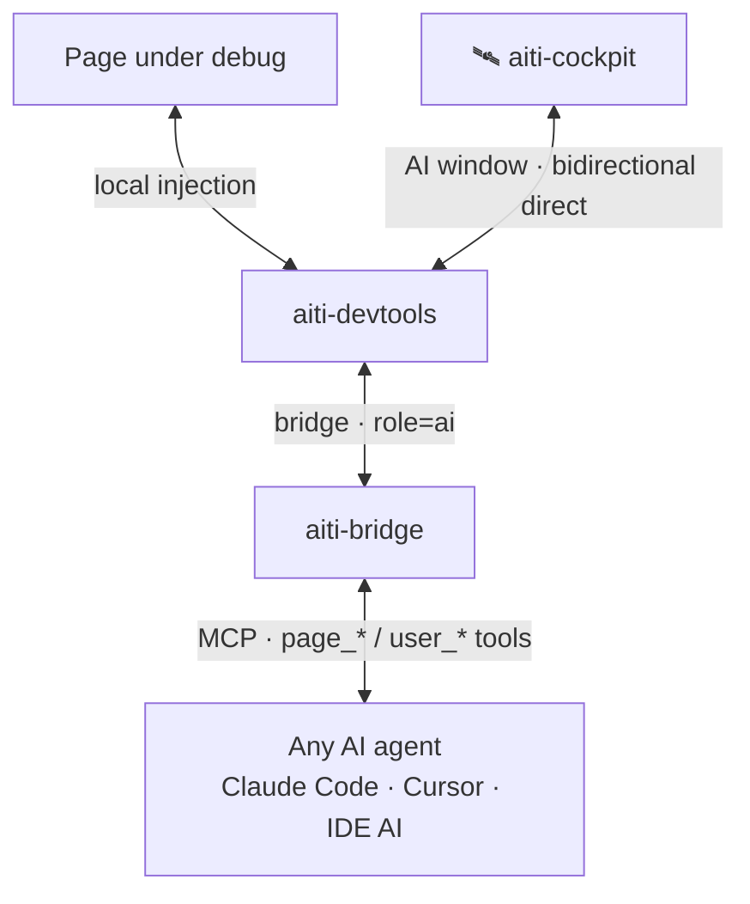

# aiti-devtools

Bring AI to the page development scene: injected debug client + Inspector + MCP bridge, so AI and humans truly collaborate **on the same page**.

> ⚠️ **Same name, different thing**: the `aiti-devtools` in the [extension registry](/en/extensions/) is a **pi-web extension** (the injector/bridge/MCP server side in pi-web scenarios); this section is about the npm-published **SDK and framework plugins** — it is not an extension.

## Documentation Map

| Document | Content |
|---|---|
| [Quick Start](quick-start.md) | The fastest way to get started |
| [The SDK](core.md) | SDK/asset distribution (core+inject, served via framework plugins or the standalone bridge — no standalone npm package): manual script wiring + integration matrix overview |
| [Injection Mechanics](inject.md) | Local inject details, the three forms, host/iframe routing |
| [CDP Command Set](cdp-commands.md) | Reference for commands across 8 domains |
| [aiti-agent Extension Points](extension-points.md) | Extension framework: slots, contracts, lifecycle |

## Framework Integrations (integrations/)

| Carrier | npm package | How to integrate | Docs | Status |
|---|---|---|---|---|
| Vite / SvelteKit / any Vite project | `@aiti-ai/aiti-devtools-vite` | `aitiDevtools()` plugin | [vite](integrations/vite.md) | ✅ |
| webpack-dev-server | `@aiti-ai/aiti-devtools-webpack` | `new AitiDevtoolsWebpackPlugin()` | [webpack-rspack](integrations/webpack-rspack.md) | ✅ |
| Rspack | `@aiti-ai/aiti-devtools-webpack` (same package reused) | zero changes | [webpack-rspack](integrations/webpack-rspack.md) | ✅ Verified |
| Nuxt | `@aiti-ai/aiti-devtools-nuxt` | one-line `modules: ['@aiti-ai/aiti-devtools-nuxt']` | [nuxt](integrations/nuxt.md) | ✅ |
| Astro | `/astro` subpath export of `@aiti-ai/aiti-devtools-vite` | one-line `integrations: [aitiAstro()]` | [astro](integrations/astro.md) | ✅ |
| Vue projects | reuses `@aiti-ai/aiti-devtools-vite` | Vite-plugin fallback | [vue](integrations/vue.md) | 📋 Standalone package planned |
| Express / Next / other Node services | `@aiti-ai/aiti-devtools-core` | manual middleware wiring | [manual](integrations/manual.md) | ✅ Guide |

> Full npm scope: `@aiti-ai/aiti-devtools-{vite,webpack,nuxt,core,inject,agent,pi}` + `@aiti-ai/aiti-bridge` — see the [plugin matrix](/en/products/aiti-devtools-plugins.md) for the package-to-carrier mapping.

## Examples

Every carrier has a minimal runnable example (unified port range 5199-5899); see the [Example Matrix](examples.md).

## Ecosystem paths: two routes, one shared page scene

**aiti-agent direct** (best experience) and the **MCP proxy** (fallback, fits any agent).

### Best experience · aiti-agent web console direct (full AI console)

> 💡 **Note**: the aiti-agent web console is the out-of-the-box default; other AIs can be adapted too — **AI products with a web console can plug into aiti-devtools directly** (same direct mode as the diagram, same page-operation and user-asking abilities).



### Fallback · MCP proxy (lite alternative to aiti-cockpit)

> 💡 **Note**: agents without a web console can still be adapted via the **aiti-bridge MCP proxy** — but **MCP message timeliness is limited** (most agents poll via `aiti_inbox` rather than being pushed), so **occasional manual nudging may be needed**; the experience is not as good as direct.



## Adapted hosts: DSH · OpenClaw · OpenCode

aiti-devtools is not locked to its own stack — these third-party agent hosts have complete adapters (all reuse the same launcher and the 16 MCP tools (page_* / user_* / aiti_* …), verified end to end):

| Host | Adapter | Highlights |
| --- | --- | --- |
| **DSH** (DeepSeek Harness) | [`@aiti-ai/aiti-devtools-dsh`](/en/extensions/aiti-devtools-dsh.md) · Cordis plugin | In-process bridge mounted at `/aiti` on one port + `agent/pre-step` placeholder rewriting + AI-window candidate bar; official web UI doubles as the AI window |
| **OpenClaw** | [`@aiti-ai/aiti-devtools-openclaw`](/en/extensions/aiti-devtools-openclaw.md) · plugin direct, skips MCP | 16 tools calling bridge REST directly + auto session online + chat.send message injection + answer relay + placeholder mapping |
| **OpenCode** | [`@aiti-ai/aiti-devtools-opencode`](/en/extensions/aiti-devtools-opencode.md) · host plugin | 16 tools registered in-process + `messages.transform` placeholder rewriting; official web UI doubles as the AI window (reverse-proxy injection, no fork) |

## Quick taste (5 minutes to "AI operates your page")

> This is the condensed version of [Quick start](/en/guide/quick-start.md) (full steps and the manual Cursor / Copilot config live there). Looking to install the **aiti web workbench** itself? See the [install guide](/en/guide/install.md).

```bash
# 1. Inject (Vite example; plain HTML can also load the launcher via <script>)
pnpm add -D @aiti-ai/aiti-devtools-vite      # vite.config.ts: plugins: [aitiDevtools()]

# 2. Start the bridge (MCP endpoint built in)
npx @aiti-ai/aiti-bridge --port 8777

# 3. Connect an AI agent — one-line stdio shim registration for Claude Code (manual Cursor / Copilot config on the quick-start page)
npx @aiti-ai/aiti-bridge --register-shim
```

When the dev server runs, 💬 / 🎯 appear bottom-right — tell the AI "use bridge_status to list the pageIds" and start debugging.

## See Also

- [Product page](/en/products/aiti-devtools.md) · [devtools plugin matrix](/en/products/aiti-devtools-plugins.md)
- [IDE plugins](/en/ide/) (vscode / idea, planned)
- [MCP bridge](/en/guide/mcp/)
