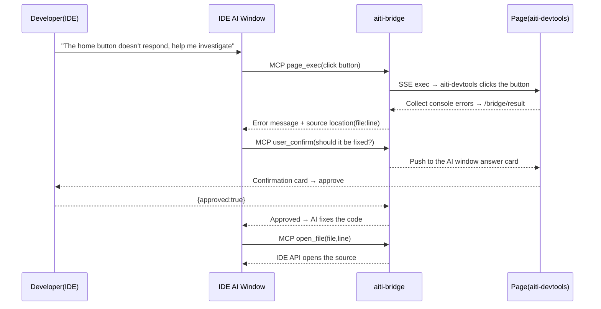

# Architecture

## 1. Layered Architecture

```
┌─────────────────────────────────────────────────────────────┐
│ L4 Entry       aiti-agent (Web) · IDE plugins · Chrome extension │
├─────────────────────────────────────────────────────────────┤
│ L3 Agent       any AI agent (MCP client)                       │
├─────────────────────────────────────────────────────────────┤
│ L2 Bridge      aiti-bridge（MCP built-in）         │
├─────────────────────────────────────────────────────────────┤
│ L1 Injection   aiti-devtools + vite/webpack/nuxt plugins         │
└─────────────────────────────────────────────────────────────┘
```

> Only three npm plugin packages exist: `@aiti-ai/aiti-devtools-vite` (with the `/astro` sub-export), `@aiti-ai/aiti-devtools-webpack`, and `@aiti-ai/aiti-devtools-nuxt`; Vue/SvelteKit projects reuse the Vite plugin, while Next/Express wire the core manually.

| Layer | Key components | Responsibility |
|---|---|---|
| L1 Injection | `inject.js` / `aiti-devtools` client / Inspector UI / CDP command set | Provides executable, collectable, interactive debugging capability inside the page |
| L2 Bridge | bridge service / MCP server / SSE / pageId sessions | Wraps page capabilities into MCP tools callable by AI, and routes sessions |
| L3 Agent | Any MCP client | Consumes `page_*` / `user_*` tools to complete AI reasoning |
| L4 Entry | aiti-agent / IDE plugins | User-facing surface and injection orchestration |

## 2. Injection Chain (Local inject)

```
Build plugin (vite/webpack/nuxt/...) or IDE plugin proxy or Chrome extension
        │ inject (prepend / transformResponse, same semantics)
        ▼
createDbgLauncher → exposed as window.__dbg
        │
        ├── host self-injection (__DBG_POST__ callback, source='self')
        ├── same-origin iframe injection (injectAllIframes + MutationObserver fallback)
        └── cross-origin iframes skipped (enumerable but not directly executable)
        │
        ▼
Message envelope: { __dbg:1, type:'dbg_*', payload, requestId, _f:frameId }
```

- Host → iframe: `postMessage({__dbg:1, _f:frameId, ...}, '*')`
- iframe → host: `parent.postMessage`; the host identifies the source by `e.source`
- Async commands: `execInPage(cmd, args, frameId)` → `requestId` enters pending → result resolves via `dbg_exec_result{requestId,...}`

## 3. Bridge Chain (MCP ⇄ Page)

```
AI (MCP client)
  │ JSON-RPC (stdio / HTTP stateless / Streamable HTTP)
  ▼
bridge: /mcp (legacy /mcp/mcp form still supported) ── tools/list · tools/call(page_exec/page_snapshot/user_*/aiti_inbox)
  │ SSE delivers exec; the page client (connected via window.BridgeClient.connect, long-lived EventSource) receives it
  ▼
exec frame forwarded into the page: postMessage({__dbg:1, type:'dbg_exec', _f:frameId})
  ▼
Host handleAiCommand → dangerous-command confirmation → execInPage routed to frameId
  │ dbg_exec_result → POST /bridge/result {pageId, requestId, ok, result}
  ▼
bridge resolves global pendingRequests → MCP response back to AI
```

- **Streamable HTTP** (2026-08): `GET /mcp` persistent stream + `Mcp-Session-Id` (the legacy `/mcp/mcp` form still supported) — the server can proactively write messages (sampling requests / progress); modern clients like pi probe it with priority automatically (see [MCP Server](/en/guide/mcp/server.md) for details).
- **Main message channel `aiti_inbox`** (2026-08): human messages / async answers / page events enter the outbox queue, and the agent calls the tool to take them away (100% available to any agent; sampling push is supported only by pi and a few others, see [Integrating AI agents](/en/guide/mcp/ai-agents.md)).
- **Human-side UI cockpit** (2026-08): onboarding guide + address configuration hub + operations console; when there is no aiUrl the AI window opens by default (see [cockpit](/en/guide/mcp/cockpit.md)).

Event direction: page events (`open_file`, `aiti_element_selected`, `user_*` answers) → bridge broadcast → AI windows (cockpit / IDE AI window) for display and answering.

## 4. Session Model (pageId)

```
pageId = instanceId/frameId
  instanceId: connection identity (pages with ports prefer the port number, e.g. 6513; otherwise random 2 letters + 3 digits, e.g. qx482)
  frameId:    target frame ('host' / 'f0' / 'f1'…)
```

- Page connects to bridge: request an `instanceId` → register each `frameId` → assemble the `pageId`; **the AI only deals with one word: `pageId`**
- Page persists `instanceId` + `secret` to localStorage → **reload reuses the old id, staying connected**
- Bridge-side TTL (default 10 minutes) retains the registry; a new id is generated only on secret mismatch or conflict
- The AI discovers all operable pageIds via `GET /bridge/sessions`

## 5. End-to-End Data Flow (IDE bug-fixing scenario)



## 6. aiti-agent-Side Architecture

```
Browser (main operations surface; pi CLI / IDE extensions share sessions via the same agent dir)
  │
  ▼
aiti-agent (Next.js, built on pi-web)
  ├── Session management (shared pi JSONL + queue persistence)
  ├── Extension runtime (registry + 29+ slots (dock-type slots keep being added) + features management + two-stage lazy loading)
  │     ├── ctx.services locator (cross-extension services) · ctx.features (switch funnel) · data tiering (config/state/cache)
  │     ├── Dependency & capability model (dependsOn/provides/takeover + extman three-view arbitration)
  │     └── aiti-event-bus (single home of the page event bus, SSE to all frames)
  ├── service-tunnels (HTTP vhost + TCP tunnels + TOTP)
  ├── pi agent SDK (in-process execution layer)
  ├── Debug visualization (M2: CDP / M3: noVNC / M1: ttyd)
  └── Tool marketplace (just get: mise → apt → npx/pipx)
```

For the extension framework's complete contract (entry fields/slots/features/styles/deployment + common-mistakes list), see [Extension Development Specification](/en/extensions/spec.md), [Extension Data and Storage Specification](/en/guide/ext-data.md), and [Lazy-Loading Contract](/en/guide/ext-lazy-loading.md) (for cross-extension service calls also see [Extension Services and Cross-Extension Call Specification](/en/guide/ext-services.md)).

> Related: [Product Matrix](/en/products/README.md) · [MCP Bridge · Sessions](/en/guide/mcp/session.md) · [Developer Tools · Injection Principles](/en/devtools/inject.md)
