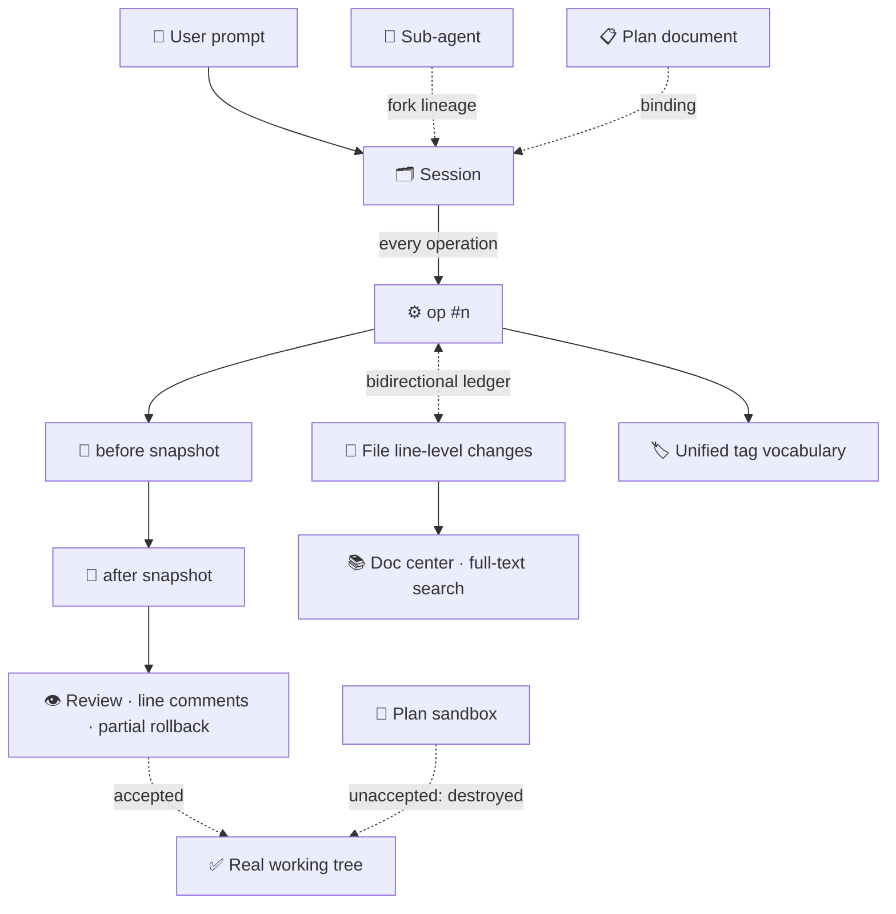

# Development Lineage

> ❝ git remembers the **content** of every change; lineage remembers the **cause and effect** of every change. ❞

## 30-Second Version

After the AI finishes editing code, git only holds a commit. It doesn't know:

- which **AI session** changed this line of code, and driven by **which prompt**;
- which **plan document** it was based on at the time, and whether that plan still holds;
- was that prompt later **withdrawn**? Which parts of the change were **accepted** into the working tree, and which were **discarded**?

aiti's **development lineage system** welds this broken chain shut: every file operation (op) the AI performs leaves before / after dual snapshots in a dedicated trace repo, bidirectionally linked with messages, sessions, plans, documents, and tags — any line of code can answer five questions:

> **Who changed it? When? Why? How? Does it still hold?**

In one sentence: **git is the history of content; lineage is the history of cause and effect.**

---

## Why "Lineage"

The industry has a family of adjacent concepts for this, each with its own focus and its own blind spots:

| Concept | Domain | What it answers | What it lacks |
|---|---|---|---|
| **Git** | Version control | What each commit changed | **Why it changed** (commit messages are free text); uncommitted working-tree state is unattributable; intermediate states after a prompt withdrawal go unaccounted for |
| **Data Lineage** (Atlas / DataHub / OpenLineage) | Data engineering | Where data comes from, where it flows, who is affected when upstream breaks | Only covers **data pipeline** tables and fields, not development activity |
| **Provenance** (W3C PROV) | Academia / archival science | What activities and what agents produced an entity | Has formal models but no engineering realization — almost nobody in dev tooling actually implements it |
| **Requirements Traceability Matrix (RTM)** | Traditional engineering | Requirements ↔ design ↔ code ↔ tests | Manually maintained; instantly obsolete in the AI era |
| **Audit Trail** | Security & compliance | Who did what and when | Records the log but **keeps no scene**; no line-level lookback, no rollback |
| **Time-travel debugging** | Debuggers (rr, etc.) | Every step of process execution | Process-level recording, not development-activity-level |

aiti's positioning is clear:

> **Take data lineage's "graph" form + W3C PROV's "cause-and-effect" semantics + git's "snapshot" infrastructure, and land it on AI development activity.**

It is called **lineage** (Chinese: 血缘, literally bloodline) rather than "tracing" because "tracing" leans toward single-point back-lookup (following one chain backwards), while "bloodline" is inherently a **graph** — our system is full of graphs: files ⇄ messages ⇄ sessions ⇄ plans ⇄ tags form a many-to-many web; forks and sub-agents form a family tree; document cross-links form a citation graph that gets PageRank computed over it.

### Why It's a Must in the AI Era

In traditional development, commit messages barely suffice (humans jot down a line or two while writing code). AI development magnifies the broken-chain problem into the norm:

1. **The prompt is the true driver of change** — yet it exists only in session records; git never sees it;
2. **One sentence can spawn a fleet of sub-agents**; the "author" of a change is a crowd of forked agents, and git only recognizes the final line of diff;
3. **Plan documents drift from code** — 800 lines of code changed, not one word of the plan touched, and no tool alerts you;
4. **"Withdraw and resend" is a high-frequency action** — after withdrawing a prompt, if the intermediate changes left in the file system go unaccounted for, the working tree stays Schrödinger-esque.

---

## The Five-Dimension Model

The lineage system is assembled from five dimensions; each answers a different question and has its own landed components:

| Dimension | Question answered | Carrying components |
|---|---|---|
| 🗂 **Session dimension** | Who did it? Which session? Forked from where? | All Sessions panel · sub-agents · unified tag vocabulary |
| ⚙️ **Operation dimension** | What exactly changed? Where is the line-level scene? | aiti-git-trace out-of-band trace repo |
| 📋 **Intent dimension** | Why the change? What does the plan say? Does it still hold? | Plan-first |
| 📚 **Knowledge dimension** | Which documents are related? How are they grouped and retrieved? | Doc center |
| ✅ **Admission dimension** | Which changes count? How to undo? | Plan sandbox · code review · three withdrawal options |

### 🗂 Session Dimension: Sessions Are First-Class Citizens

- **All Sessions panel**: pi / Claude Code / Codex / Qoder / any ACP agent managed side by side; historical sessions are not fossils — one click revives them. The tag tree attached to sessions is the **system-wide unified tag vocabulary** — AI tagging, document inheritance, and UI autocomplete all defer to it.
- **Sub-agent lineage**: sub-agents are not black-box processes but fully persisted forked sessions; the `parentSession` header marks the parent-child relation. The trace repo records the `parent/forkFrom` chain in sync, and the `/lineage` aggregation endpoint can assemble the entire family tree by ancestor-root-first + BFS + generation; the timeline's third tab renders it directly as a tree.
- **Tag vocabulary**: nested tags (`ProjectA/ModuleB`) group everything horizontally — sessions, documents, and plans share one vocabulary; this is the "column index" of the lineage graph.
- **⚠ Tracing boundary**: the op ledger / trace repo only covers **pi runtime sessions** (where tool_call interception lives). External agents managed side by side in All Sessions (Claude Code / Codex / Qoder / ACP bridged sessions) are **not within tracing scope** — they appear in the session dimension and the family tree, but produce no op rows in the operation dimension. Mid-term plan: backfill the ledger on session import (lightweight, to be reviewed separately).

### ⚙️ Operation Dimension: The op Is the Atomic Unit

aiti-git-trace builds an **out-of-band trace repo** for every session (`.aiti-trace`, a fully independent git repository):

- For every file-modifying operation (op) the AI performs, a numbered commit is taken **before and after execution** — not just a running log, but a complete scene snapshot;
- The ledger welds **files ⇄ ops ⇄ messages ⇄ sessions** bidirectionally: from a line of code you can follow the vine to the prompt behind it, and from a message you can list every file it touched;
- **Three timeline views**: by message, by file, by family tree;
- Files changed by humans outside the cwd (redirected to $HOME, editor absolute paths, …) are brought under the **watched-path model**; changes not covered still get leak bookkeeping (recorded, not blocked).

### 📋 Intent Dimension: Plan-First

- Sessions ↔ plan documents are explicitly **bound**: a binding wizard pops up automatically when an md change appears; one-click `@file` also works;
- Plan documents carry **lifecycle tags**: `方案/评审中` → `方案/已实施` → `方案/已过时`, written into front-matter by the AI per convention (**convention-based**: no forced validation; violations are caught by self-checks / manual correction);
- **Drift awareness**: heavy code changes while the plan didn't follow → proactively remind to "update the plan document"; entering any session first checks the lineage ledger — sessions taken over mid-way, running in terminals, or that missed events can also get their binding backfilled.

The intent dimension is the "reverse chain": from code back to requirements. RTM relies on humans filling in tables; here it grows automatically out of events.

### 📚 Knowledge Dimension: The Doc Center

- Document ↔ session associations consume the operation dimension's ledger directly: **"which sessions wrote this document" is one query away**, and vice versa;
- **Six tag sources, two tiers**: front-matter, inline `#tag` in the body (Obsidian-compatible), path-derived, and manual write-back form the static tier; plan binding and session tag inheritance form the dynamic tier (in-memory join, not persisted) — **documents get organized even without tags**;
- md cross-links / `[[wiki]]` / `@path` form a **citation graph**; document-level PageRank is computed and folded into search ranking; node:sqlite FTS5 trigram provides Chinese full-text search.

### ✅ Admission Dimension: What Counts and How to Undo

Lineage doesn't just record; it also answers "which changes count":

- **Plan sandbox**: plan mode no longer ties the AI's hands — it replaces the floor beneath its feet. All experiments happen inside a disposable snapshot; at the end the AI must declare deliverables via the hard protocol `declare_deliverables`, the user accepts file by file, and **unaccepted content is destroyed with the snapshot** (deletion requires explicit per-item confirmation);
- **Three withdrawal options**: when withdrawing a prompt, what happens to the file changes — withdraw / keep / pick individually — is decided by the user; and **the withdrawal itself is recorded** (append-only history, so you can regret the regret);
- **Review and line-level rollback**: the reviewer consumes lineage data directly — open the diff of any op range with trace as the source, Monaco line anchors auto-remapped, AI pre-review, line-level comments, and **one-click partial rollback** of selected lines (patch-style; the write path is consolidated into the trace repo's single writer; conflicts fall back to safety commit + three-way merge).

---

## A Real Chain (Walking Through the Five Attribution Questions)

> "The exponential backoff at line 42 of `src/retry.ts` — who actually wrote it?"

| Question | The lineage system's answer |
|---|---|
| **Who changed it?** | Session `S-3f2a` (pi · 2026-09-12 14:32), a sub-agent "retry-refactor" forked from `S-1d09` — a tree in the family-tree view |
| **Why?** | User prompt: "change fixed retries to exponential backoff"; the session is bound to plan `docs/retry-plan.md`, tag: `方案/已实施` |
| **How?** | op #47, before/after dual snapshots; the diff shows ±6 lines, including this line |
| **Does it still hold?** | The line has one line-level comment in review; no rollback has occurred → currently in effect |
| **What else is related?** | Under the same tag `retry` there are 3 more documents and 2 more sessions; every update to this plan lives in the document timeline |

In traditional toolchains, answering these five questions means digging through git log, session records, plan directories, and piecing things together from memory — in the lineage system it's **five clicks**.

### Mapping to W3C PROV

Not a coincidence: the lineage system's data model is naturally isomorphic to W3C PROV (the de facto standard formal model in the provenance field):

| W3C PROV | In the lineage system |
|---|---|
| Entity | File state snapshots (before / after), plan documents, sandbox deliverables |
| Activity | op (numbered operation), turns, sessions, forks |
| Agent | AI agent (model × session identity), human user (prompt author) |
| wasGeneratedBy | after snapshot ← op |
| used | op → before snapshot |
| wasAssociatedWith | op → session → agent |
| wasDerivedFrom | new file state ← prompt / plan document |
| wasInvalidatedBy | rollback (and the rollback itself is also a recorded op) |

The difference: PROV stayed in papers and standards; here every relation has **on-disk git objects and a clickable UI**.

---

## Design Principles (Why We Dare Call It Innovative)

1. **Zero intrusion**: the trace repo is an independent git repository; the user's `status` / `stash` / `clean` / `gc` / remote pushes are completely unaffected; the two stores are mutually unaware. Deleting the trace directory = uninstalling tracing — what you see is what you get.
2. **append-only**: history is append-only. Withdrawals and rollbacks are themselves recorded ops — regret is on record, and you can even regret the regret.
3. **The AI cannot bypass it**: the tracer hangs at the **tool-call layer** (tool_call precedes execution and can be intercepted); it relies on neither AI self-discipline nor prompt promises — "all output is accounted for" is guaranteed by mechanism, not verbal agreement.
4. **Zero polling**: a ledger row landing is an event (sink → traceBus → SSE / onOp); a push-listen architecture end to end, zero scanning in the steady state.
5. **User sovereignty**: whether to withdraw, and what to withdraw, is always the user's call; unaccepted sandbox content is destroyed; deletions are confirmed item by item.
6. **Consumption reuse**: the reviewer consumes lineage data directly (no reinventing the diff wheel); the doc center, message intelligence, and plan-first all subscribe to the same event stream — one lineage, the whole family benefits.

## Boundaries (No Overselling)

- **Not tracking every human keystroke**: manual edits get incidentally captured in the before snapshot of the next op, existing as the "pre-op scene".
- **Purely local**: the trace repo is never uploaded or pushed; it is positioned as a process asset, not off-site backup.
- **Guards against accidents, not adversaries**: the threat model is "the clumsy strong colleague", not a malicious attacker — no security theater.
- **Tracks even without a git directory**: a repo is auto-created within budget (full-domain tracing); changes outside the cwd go through watched paths and leak bookkeeping — recorded, not blocked.

---

## Component Map

| Dimension | Component | One-line role | Further reading |
|---|---|---|---|
| Session | [All Sessions](/en/extensions/session-manager.md) | Multi-agent side by side + unified tag vocabulary | Extension page |
| Session | [Sub-agents](/en/extensions/aiti-subagents.md) | Sub-agent = forked session, parentSession lineage | Extension page |
| Operation | aiti-git-trace | Out-of-band trace repo, op ledger, family tree `/lineage` | `dev-repo/docs/aiti-git-trace-plan.md` |
| Intent | [Plan-first](/en/extensions/aiti-plan-first.md) | Plan binding, lifecycle tags, drift reminders | Extension page |
| Knowledge | aiti-doc-center | Six tag sources, doc⇄session, PageRank, FTS | `dev-repo/docs/aiti-doc-center-plan.md` |
| Admission | plan-sandbox | Disposable snapshots, deliverable acceptance via hard protocol | `dev-repo/docs/pi-plan-sandbox-final-design.md` |
| Admission | [Code review](/en/extensions/aiti-git-review.md) | Trace-sourced review, line-level partial rollback | Extension page |
| Isomorphic instance | [Config safety net](/en/extensions/aiti-configs.md) | The same versioning and rollback applied to the config domain | Extension page |

## Outlook

The current form of lineage covers a single machine, a single repo, development time. Directions going forward (brainstorms, not promises):

- **Cross-repo lineage graph**: lineage from multiple projects and workspaces aggregated into one global graph;
- **Lineage queries**: "list all days of heavy changes whose plans didn't follow", "all ops under this tag that were ever rolled back";
- **Standard export**: PROV-N / JSON-LD serialization, plugging into enterprise data governance and compliance audits;
- **Team-level lineage**: sessions and plans shared across members; newcomers first read "the lineage history of this code".

---

> Further reading: [What is aiti](/en/guide/what-is-aiti.md) · [Architecture](/en/guide/architecture.md) · [Code review](/en/extensions/aiti-git-review.md) · [Plan-first](/en/extensions/aiti-plan-first.md)
>
> 📌 Implementation status: this page is the **vision panorama** of the five-dimension lineage. For landing progress of each promise, known gaps, and the convergence plan (git-trace ⇄ plan-sandbox homogenization, acceptance bookkeeping, cross-dimension navigation, etc.), see `dev-repo/docs/aiti-lineage-closure-plan.md` (deep audit of development-lineage implementation gaps and optimization plan).
>
> ✅ **Closure progress (2026-09)**: among the 36 gaps found in the deep audit, the high-impact items have been triaged and shipped — **three P0 items** (per-op rollback contract, parent-chain wiring fixing the "family tree always empty" bug, terminal-state persistence) + **P1** (ledger unification / intent dimension / self-check / cross-dimension navigation, GAP-1/2/3/4/5); ledger rows gained the additive `planRel` field (plan binding written into rows, P1-2); the aiti-plan-review extension landed the Plan-Sandbox acceptance wrap-up UI. P2/P3 batches are tracked in the closure plan ledger.
