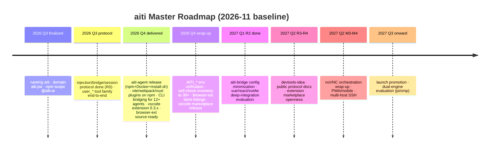

# aiti Master Plan

> **Living document**: this document is the single master plan of the aiti ecosystem and is continuously updated. Each time a step is completed, update the corresponding status marker (✅ done / 🚧 in progress / 📋 pending).
> **Current-state baseline**: per-product status lives in the [Product Matrix](/en/products/README.md) as the single source of truth; this page and the roadmaps only describe plans, milestones, and acceptance criteria.
> In one sentence: **use pi as the engine to build a trinity AI development tool ecosystem of "Web workbench + local injection + MCP bridge"** —
> the Web workbench as the primary operating surface, compatible with and derived from the same source as pi CLI / IDE extensions (aiti-agent), local injection into mainstream development tools (aiti-devtools), and any AI agent reaching straight into IDE windows (aiti-bridge).

---

## 0. One-Page Summary

| Dimension | Conclusion |
|---|---|
| What to build | Our own AI development tool ecosystem: self-hosted workbench + in-page debugging injection + AI agent enablement |
| Foundation | agegr/pi-web serves as the upstream baseline; this project's own layers (service-tunnels, queue crash recovery, ...) are built on top |
| Engine | pi (earendil-works/pi, 122k★, daily releases, managed by mise) |
| Differentiation | Shared JSONL sessions + real workspaces + service tunnels + **AI collaborating live with pages/IDEs** (no one else has all five) |
| Product matrix | 14 products covering the entry / injection / bridge / Agent layers (see [Product Matrix](/en/products/README.md)) |
| Brand | aiti · domain `aiti.pw` (live) · GitHub `aiti-ai` · npm scope `@aiti-ai` |
| North star | Daily usable by ourselves → 10+ active external users → 5+ external contributors |
| Current status (2026-11) | aiti-agent 0.15.x released (npm + Docker core/full + install.sh); carrier plugins vite/webpack/nuxt published; aiti-bridge 0.2.x published; vscode extension 0.3.x and browser-ext source-ready pending store release; CLI bridging for 12+ agents; R1 wrap-up in progress |

---

## 1. Product Matrix (One Diagram)

```
┌──────────────────────────────────────────────────────────────────┐
│ L4 Entry     aiti-agent(Web+Docker) · devtools-vscode/idea · browser-ext │
├──────────────────────────────────────────────────────────────────┤
│ L3 Agent     12 CLI adapters · Claude Code · Cursor · IDE AI · aiti-agent │
├──────────────────────────────────────────────────────────────────┤
│ L2 Bridge    aiti-bridge（MCP built-in + stdio⇄HTTP shim）        │
├──────────────────────────────────────────────────────────────────┤
│ L1 Injection aiti-devtools · vite/webpack/nuxt carrier plugins   │
└──────────────────────────────────────────────────────────────────┘
```

| Layer | Product | Status | Milestone |
|---|---|---|---|
| L1 | aiti-devtools (injection SDK, bundled with pi-web + carrier plugins) | ✅ | — |
| L1 | Carrier plugins vite / webpack / nuxt | ✅ 0.1.x on npm | R2 wrap-up (vue/react/svelte deep-integration evaluation) |
| L1 | browser-ext (Chrome extension, form ② zero-code injection) | 🚧 source-ready (store assets & publishing guide done) | R2 store listings |
| L2 | aiti-bridge / server | ✅ 0.2.x on npm | R1 finish config minimization |
| L3 | Any AI agent onboarding | ✅ 12 CLI adapters + [onboarding docs](/en/guide/mcp/ai-agents.md) | ongoing |
| L4 | aiti-agent (based on pi-web) | ✅ 0.15.x (npm + Docker + install.sh) | M3/M4 wrap-up |
| L4 | devtools-vscode | 🚧 0.3.x source-ready (not on marketplaces yet) | R3 marketplace release |
| L4 | devtools-idea | 📋 | R3 |

---

## 2. Goals and Principles

### 2.1 Three Main Lines

1. **Main line A · aiti-agent**: a self-hosted Web workbench powered by pi — the primary browser operating surface (compatible with pi CLI / IDE extensions), one-command Docker startup, visualized remote debugging.
2. **Main line B · aiti-devtools**: embedded into mainstream development tools (Vite/Webpack/Nuxt…), **local injection**, AI collaborating live with the page.
3. **Main line C · aiti-bridge**: configuration for aiti-devtools usage, **AI agent enablement**, supporting aiti-devtools and vscode/idea plugins to complete injection, **messages delivered straight into IDE AI agent windows**.

### 2.2 Principles

- **Product first, promotion later**: no launch until features are complete; the north-star metric is using it ourselves first.
- **One injection script, reused in three forms**: active adaptation / Chrome extension / IDE plugin, with the same bridge protocol.
- **Minimal configuration**: AI only needs to be told a single `pageId`; everything else is automatic (the ID lifecycle is controlled page-side).
- **Secure by default off**: debugging components are disabled by default; explicit enablement + TOTP + non-root + allowlist.

---

## 3. Milestone Roadmap



### Main Line B/C Milestones (Injection + Bridge)

| Phase | Goal | Deliverables | Status |
|---|---|---|---|
| **R0 · Protocol** | Injection/bridge/session protocol end-to-end | Injection script + MCP bridge + pageId session system + user_* interaction tool family end-to-end; full bridge endpoints | ✅ |
| **R1 · Core usable** | Developers work out of the box | npm package matrix published (core / inject / vite / webpack / nuxt / bridge); remaining: `AITI_*` unification, self-check inventory to 30+, README/demo polish | 🚧 |
| **R2 · Plugin matrix** | Embed into mainstream dev tools | vite/webpack/nuxt ✅ published; browser-ext 🚧 pending store listings; vue/react/svelte reuse the Vite plugin for now (deep integration 📋); aiti-bridge config minimization wrap-up | 🚧 |
| **R3 · IDE plugins** | Messages delivered into IDE AI windows | vscode 0.3.x source-ready (injection + bridge + MCP wiring + AI window jump); idea 📋 | 🚧 |
| **R4 · Platform** | Open ecosystem | extension marketplace (npm + MCP registry data sources), public protocol docs, contribution guide | 📋 |

### Main Line A Milestones (Web Workbench)

| Phase | Goal | Deliverables | Status |
|---|---|---|---|
| **M0 · Foundation** | Stable core + independent identity | ① naming/branding ✅ ② upstream tracking (originally rebase v0.8.7; evolved into continuous upstream sync, now 0.15.x) ③ CI verification chain ✅ ④ service-tunnels public release ✅ ([standalone GitHub repo](https://github.com/aiti-ai/service-tunnels)) | ✅ |
| **M1 · Workbench v1** | Real work done remotely | Docker core/full dual images ✅ (beyond the lite plan; 4-language README + compose + systemd); terminal delivered as the aiti-cmd PTY panel ✅ (form replaces the original ttyd plan); WS link resolved in production ✅; `just get` tool marketplace 📋 | 🚧 |
| **M2 · Browser debugging** | Debug Chrome remotely | CDP channels wired in: chrome-devtools / msedge-cdp / remote-cdp MCP servers; complementary to devtools `page_exec` (lightweight in-page command set); sessiond evaluation 📋 | ✅ core |
| **M2.5 · CLI bridging** (side line) | Any AI CLI into the Web | 12 CLI adapter extensions live: Claude Code / Codex / OpenCode / Cursor / ZCode / Qoder / CodeBuddy / OMP / ACP (generic) / custom-agent registry, etc.; docs in [AI agent onboarding](/en/guide/mcp/ai-agents.md) | ✅ delivered beyond plan |
| **M3 · Desktop visualization** | View/operate GUI remotely | computer-use MCP + VNC password contract in place; noVNC desktop (full image) orchestration / TOTP orchestration 📋 | 🚧 |
| **M4 · Productization** | People actually want it | editor suite (aiti-editor / onlyoffice / sheet-univer / word preview) ✅; PWA/mobile 📋; multi-host SSH 📋; launch promotion 📋 | 🚧 |
| **Ecosystem phase** | A real community | external PRs, addons, engine abstraction (pi/omp dual-engine evaluation) | 📋 |

---

## 4. Key Decision Records (ADR Summary)

| # | Decision | Conclusion | Rationale |
|---|---|---|---|
| D1 | Upstream refuses to merge PRs | Keep syncing from upstream as the starting point, weekly rebase | Usability first, independence later |
| D2 | jmfederico is a competitor, not a sequel | Cannot merge his code; can only learn from features | fork:false, different stack, brand confusion |
| D3 | Ecosystem fragmentation → race for the mainline? | Do not fight the mainline battle; just build our own features well | High cost, uncertain payoff |
| D4 | Product positioning upgrade | From "following upstream" to "our own development tools" | User made it explicit: independent brand / independent boundary |
| D5 | Remote debugging feature set | CDP/VNC/terminal trio; WS link verified in production | Proven against PiClaw; service-tunnels can expose with zero changes |
| D6 | Tool marketplace form | `just get <tool>` as the unified installer (mise → apt → npx/pipx) | just 35k★ / mise 32k★ |
| D7 | Promotion timing | Product first, promotion later (launch after M1) | Low conversion without terminal/Docker |
| D8 | omp (Oh My Pi) | Mainline binds to pi; session-level omp adaptation exists (aiti-omp-agent); M4 deep dual-engine evaluation | omp 22.5k★, incompatible session format, no mature Web UI |
| D9 | devtools target routing | Host target routing instead of a self-built targetFrame: target = host + host's real iframe | inject does not build its own targetFrame |
| D10 | MCP session naming | `token → instanceId`, `uid → frameId`, combined into `pageId` | Clear responsibilities, minimal configuration |
| D11 | User interaction protocol | `user_*` tool family as its own class (confirm/choose/input/pick/presence/notify) | Tool name is the semantics; return shapes differ |
| D12 | npm scope | `@aiti-ai/*` (bare 3-4 letter names rejected by npm anti-squatting controls) | Verified 404/rejection |
| D13 | Domain | `aiti.pw` as the main site (website/docs/endpoints) | Applied on 2026-08-08, now live |
| D14 | Repo structure: aiti-ai = release mirror repo and runtime host | dev/prod both run from the aiti-ai repo; development happens in an internal source repo, mirrored one-way into the release repo | Single source of truth; build/release/runtime on one chain |
| D15 | npm public release chain | staging → verification → promote-to-npmjs three stages (publish-npm.yml); main-package Release and Docker releases guarded by dependency checks with fail-fast | Local direct publishing hits 2FA (EOTP) and lacks provenance |
| D16 | Extension ecosystem going public | a single internal source repo; extensions/ is mirrored one-way in full to the public repo (script + audit; no manual edits on the release-repo side) | Prerequisite for npm publishing and R4 ecosystem openness |

---

## 5. Current State Snapshot (2026-11)

> **The per-product source of truth is the [Product Matrix](/en/products/README.md)**; this section keeps only a phase-level summary.

- **Delivered ✅**: aiti-agent 0.15.x (npm + Docker core/full + install.sh); aiti-bridge 0.2.x; carrier plugins vite/webpack/nuxt; CLI bridging for 12+ agents; CDP debugging channels; aiti.pw docs site
- **Wrapping up 🚧**: `AITI_*` env unification (22 DBG_ remnants in product sources); self-check inventory; vscode extension and browser-ext store releases; bridge claim/secret/TTL regression documentation
- **Not started 📋**: devtools-idea; vue/react/svelte deep integration (Vite plugin reuse for now); PWA/mobile; multi-host SSH; launch promotion; extension marketplace openness

---

## 6. Risks and Mitigations

| Risk | Mitigation | Status |
|---|---|---|
| WS link | Production runs stably on nginx + SSE; HMR websocket via nginx map | ✅ mostly resolved |
| pi daily releases, API drift | Continuous upstream sync (rebase cadence + check script); mise version pinning | 🚧 |
| Image size | Multi-stage build + core/full dual tags | ✅ delivered |
| Security surface (VNC/CDP/terminal/injection) | default off + TOTP + non-root + allowlist + gesture bridge | ✅ designed |
| Solo maintainer load | feature selection decided by "do I use it myself"; CI automation | 🚧 |
| CDP tool token consumption | optional skill, not loaded by default | 📋 |
| Competition with PiClaw | compete on positioning, not feature count (shared sessions + real workspace + tunnels) | ✅ decided |
| Engine lock-in (pi vs omp) | mainline binds to pi; omp session adaptation exists; M4 evaluates dual engine | 🚧 |
| IDE AI window extension-point changes | panel fallback (cockpit) as safety net; vscode extension already implements the jump | 🚧 fallback ready |

---

## 7. Todo List

- [ ] **Stabilize aiti-devtools**: `DBG_*` → `AITI_*` (22 remnants in sources), materialize the self-check inventory and expand to 30+
- [ ] **browser-ext store listings**: Chrome Web Store / Edge Add-ons / Firefox AMO (assets and publishing guide ready)
- [ ] **vscode extension marketplace release**: VS Code Marketplace + Open VSX
- [ ] **aiti-bridge config minimization wrap-up**: claim/secret/TTL full verification; sessions discovery documented
- [ ] **Public protocol docs as a system**: bridge protocol, pageId sessions, injection script spec → ecosystem openness (R4)
- [ ] **vue/react/svelte deep-integration evaluation** (Vite plugin reuse for now)
- [ ] **Kick off devtools-idea** (JetBrains)
- [ ] **`just get` tool marketplace evaluation** (original M1 item)
- [ ] **PWA / mobile / multi-host SSH**
- [ ] **First promotion launch** (channels and material in the [aiti-agent roadmap](/en/roadmaps/aiti-agent.md))

---

## 8. Document Index

| Document | Content |
|---|---|
| **This document** | The master plan overview |
| [Product Matrix](/en/products/README.md) | Panorama of 14 products (single source of truth for current state) |
| [aiti-agent roadmap](/en/roadmaps/aiti-agent.md) | Web workbench phased plan |
| [aiti-devtools roadmap](/en/roadmaps/aiti-devtools.md) | Injection ecosystem plan |
| [aiti-bridge roadmap](/en/roadmaps/aiti-bridge.md) | Bridge layer plan |
| [Guide · Architecture](/en/guide/architecture.md) | Layered architecture and data flow |
| [MCP Bridge · Sessions](/en/guide/mcp/session.md) | pageId session system |
