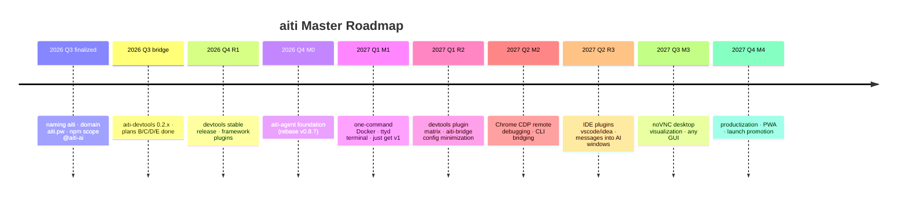

# aiti Master Plan

> **Living document**: this document is the single master plan of the aiti ecosystem and is continuously updated. Each time a step is completed, update the corresponding status marker (✅ done / 🚧 in progress / 📋 pending).
> In one sentence: **use pi as the engine to build a trinity AI development tool ecosystem of "Web workbench + local injection + MCP bridge"** —
> the Web workbench as the primary operating surface, compatible with and derived from the same source as pi CLI / IDE extensions (aiti-agent), local injection into mainstream development tools (aiti-devtools), and any AI agent reaching straight into IDE windows (aiti-bridge).

---

## 0. One-Page Summary

| Dimension | Conclusion |
|---|---|
| What to build | Our own AI development tool ecosystem: self-hosted workbench + in-page debugging injection + AI agent enablement |
| Foundation | Built on the open-source project agegr/pi-web (the only service-tunnels / queue recovery in the whole ecosystem) |
| Engine | pi (earendil-works/pi, 85k★, daily releases, managed by mise) |
| Differentiation | Shared JSONL sessions + real workspaces + service tunnels + **AI collaborating live with pages/IDEs** (no one else has all five) |
| Product matrix | 14 products covering the entry / injection / bridge / Agent layers (see [Product Matrix](/en/products/README.md)) |
| Brand | aiti · domain `aiti.pw` · GitHub `aiti-ai` · npm scope `@aiti-ai` |
| North star | Daily usable by ourselves → 10+ active external users → 5+ external contributors |
| Current status | Naming decided (aiti); aiti-devtools 0.2.x usable (self-check 21/21); bridge link working; aiti-agent M0 pending |

---

## 1. Product Matrix (One Diagram)

```
┌─────────────────────────────────────────────────────────────┐
│ L4 Entry     aiti-agent(Web+Docker) · devtools-vscode/idea   │
├─────────────────────────────────────────────────────────────┤
│ L3 Agent     Claude Code · Cursor · IDE AI · aiti-agent      │
├─────────────────────────────────────────────────────────────┤
│ L2 Bridge    aiti-bridge（MCP built-in）          │
├─────────────────────────────────────────────────────────────┤
│ L1 Injection aiti-devtools · vite/vue/next/react/svelte pkgs │
└─────────────────────────────────────────────────────────────┘
```

| Layer | Product | Status | Milestone |
|---|---|---|---|
| L1 | aiti-devtools (core package) | ✅ 0.2.x self-check 21/21 | R1 stabilize + release |
| L1 | devtools-vite/vue/next/react/svelte | 📋 | R2 |
| L2 | aiti-bridge / server | 🚧 bridge link working | R2 finish config minimization |
| L3 | Any AI agent onboarding | ✅ protocol ready | ongoing |
| L4 | aiti-agent (based on pi-web) | 📋 M0 | M0-M4 |
| L4 | devtools-vscode / idea | 📋 | R3 |

---

## 2. Goals and Principles

### 2.1 Three Main Lines

1. **Main line A · aiti-agent**: a self-hosted Web workbench powered by pi — the primary browser operating surface (compatible with pi CLI / IDE extensions), one-command Docker startup, visualized remote debugging.
2. **Main line B · aiti-devtools**: embedded into mainstream development tools (Vite/Vue/Next/React/Svelte), **local injection**, AI collaborating live with the page.
3. **Main line C · aiti-bridge**: configuration for aiti-devtools usage, **AI agent enablement**, supporting aiti-devtools and vscode/idea plugins to complete injection, **messages delivered straight into IDE AI agent windows**.

### 2.2 Principles

- **Product first, promotion later**: no launch until features are complete; the north-star metric is using it ourselves first.
- **One injection script, reused in three forms**: active adaptation / Chrome extension / IDE plugin, with the same bridge protocol.
- **Minimal configuration**: AI only needs to be told a single `pageId`; everything else is automatic (the ID lifecycle is controlled page-side).
- **Secure by default off**: debugging components are disabled by default; explicit enablement + TOTP + non-root + allowlist.

---

## 3. Milestone Roadmap



### Main Line B/C Milestones (Injection + Bridge)

| Phase | Goal | Deliverables | Status |
|---|---|---|---|
| **R0 · Protocol** | Injection/bridge/session protocol end-to-end | Plans B/C/D/E ✅; aiti-devtools 0.2.x (21-item self-check); full bridge endpoints | ✅ |
| **R1 · Core usable** | Developers work out of the box | `@aiti-ai/aiti-devtools` official release; README/demo polish; `AITI_*` env vars unified | 🚧 |
| **R2 · Plugin matrix** | Embed into mainstream dev tools | devtools-vite/vue/next/react/svelte; aiti-bridge config minimization wrap-up; Chrome extension | 📋 |
| **R3 · IDE plugins** | Messages delivered into IDE AI windows | devtools-vscode / devtools-idea (injection + bridge + AI window panel + answer cards) | 📋 |
| **R4 · Platform** | Open ecosystem | extension marketplace (npm + MCP registry data sources), public protocol docs, contribution guide | 📋 |

### Main Line A Milestones (Web Workbench)

| Phase | Goal | Deliverables | Status |
|---|---|---|---|
| **M0 · Foundation** | Stable core + independent identity | ① naming/branding ✅ ② rebase v0.8.7 ③ verification chain ④ service-tunnels public release | 📋 |
| **M1 · Workbench v1** | Real work done remotely | Docker (lite) + `just get` v1 + ttyd terminal + **WS link field-tested** | 📋 |
| **M2 · Browser debugging** | Debug Chrome remotely | CDP 9222 exposure + DevTools + cdp tools + sessiond evaluation | 📋 |
| **M2.5 · CLI bridging** (side line) | Any AI CLI into the Web | lib/cli/ adapter layer (Claude Code live / Codex·OpenCode turn-based) | 📋 |
| **M3 · Desktop visualization** | View/operate GUI remotely | noVNC desktop (full image) + any GUI + TOTP orchestration | 📋 |
| **M4 · Productization** | People actually want it | editor, PWA/mobile, multi-host SSH, launch promotion | 📋 |
| **Ecosystem phase** | A real community | external PRs, addons, engine abstraction (pi/omp dual-engine evaluation) | 📋 |

---

## 4. Key Decision Records (ADR Summary)

| # | Decision | Conclusion | Rationale |
|---|---|---|---|
| D1 | Upstream refuses to merge PRs | Keep syncing from upstream as the starting point, weekly rebase | Usability first, independence later |
| D2 | jmfederico is a competitor, not a sequel | Cannot merge his code; can only learn from features | fork:false, different stack, brand confusion |
| D3 | Ecosystem fragmentation → race for the mainline? | Do not fight the mainline battle; just build our own features well | High cost, uncertain payoff |
| D4 | Product positioning upgrade | From "following upstream" to "our own development tools" | User made it explicit: independent brand / independent boundary |
| D5 | Remote debugging feature set | CDP/VNC/ttyd trio; WS link field-tested in M1 | Proven against PiClaw; service-tunnels can expose with zero changes |
| D6 | Tool marketplace form | `just get <tool>` as the unified installer (mise → apt → npx/pipx) | just 35k★ / mise 32k★ |
| D7 | Promotion timing | Product first, promotion later (launch after M1) | Low conversion without terminal/Docker |
| D8 | omp (Oh My Pi) | Mainline binds to pi; M0 verifies @oh-my-pi SDK compatibility; M4 dual-engine as fallback | omp 22.5k★, incompatible session format, no mature Web UI |
| D9 | devtools target routing | Plan C (host target routing) replaces plan B: target = host + host's real iframe | inject does not build its own targetFrame |
| D10 | MCP session naming | `token → instanceId`, `uid → frameId`, combined into `pageId` | Clear responsibilities, minimal configuration |
| D11 | User interaction protocol | `user_*` tool family as its own class (confirm/choose/input/pick/presence/notify) | Tool name is the semantics; return shapes differ |
| D12 | npm scope | `@aiti-ai/*` (bare 3-4 letter names rejected by npm anti-squatting controls) | Verified 404/rejection |
| D13 | Domain | `aiti.pw` as the main site (website/docs/endpoints) | Applied on 2026-08-08 |

---

## 5. Current State (2026 Q3)

### Done ✅

- **Brand identity**: named aiti, domain aiti.pw, GitHub org aiti-ai, npm scope @aiti-ai
- **aiti-devtools 0.2.x**: all 21/21 self-checks pass (verified on both native HTML and React); Inspector/HUD/event freezing/speed panel/CDP-like 42 commands/framework detection/MCP bridge/refresh recovery/security boundaries
- **Plans B/C/D/E**: host target routing, MCP bridge session system (pageId), user interaction tool family (user_*) implemented end to end
- **Bridge link**: SSE page bridge + global pendingRequests + event broadcasting (open_file); service-tunnels integrated injection (transformResponse prepend)
- **Research**: pi-web ecosystem panorama, upstream lineage, omp, CLI interaction, tool marketplace, promotion plan

### In Progress 🚧

- aiti-devtools official release (stabilize 0.2.x → 1.0)
- `AITI_*` env var unification (DBG_* → AITI_*)
- aiti-agent M0 (rebase + verification chain)

### Pending 📋

- devtools framework plugin matrix (vite/vue/next/react/svelte)
- IDE plugins (vscode/idea)
- aiti-agent M1-M4
- Extension marketplace / public protocol docs

---

## 6. Risks and Mitigations

| Risk | Mitigation | Status |
|---|---|---|
| WS link (field-tested in M1) | Next16 proxy rewrite field test; fall back to TCP tunnel if it fails | 📋 |
| pi daily releases, API drift | CI auto-upgrade + mise version pinning | 📋 |
| Image size 1-2GB | multi-stage + lite/full dual tags | 📋 |
| Security surface (VNC/CDP/terminal/injection) | default off + TOTP + non-root + allowlist + gesture bridge | ✅ designed |
| Solo maintainer load | feature selection decided by "do I use it myself"; CI automation | 📋 |
| CDP tool token consumption | optional skill, not loaded by default | 📋 |
| Competition with PiClaw | compete on positioning, not feature count (shared sessions + real workspace + tunnels) | ✅ decided |
| Engine lock-in (pi vs omp) | mainline binds to pi; M0 verifies SDK compatibility; M4 evaluates dual engine | 📋 |
| IDE AI window extension-point changes | panel fallback (cockpit) as safety net | 📋 |

---

## 7. Todo List

- [ ] **Stabilize aiti-devtools before 1.0**: 0.2.x release polish, `AITI_*` unification, self-check expansion (21 → 30+)
- [ ] **devtools plugin matrix**: vite first (R2), vue/next/react/svelte to follow
- [ ] **aiti-bridge config minimization wrap-up**: claim/secret/TTL full verification; sessions discovery documented
- [ ] **aiti-agent M0**: rebase v0.8.7, verification chain, service-tunnels public release
- [ ] **IDE plugins (R3)**: vscode first (injection + bridge + Copilot Chat panel), idea to follow
- [ ] **Domain/hosting**: once aiti.pw DNS takes effect, configure the site (overseas hosting, no ICP filing needed)
- [ ] **npm cleanup**: `npm unpublish @aiti-ai/aiti@0.0.0` (placeholder dirty version; run after docs migration completes)
- [ ] **GitHub repositories**: aiti-ai/aiti, aiti-ai/aiti-docs, aiti-ai/aiti-devtools, etc.
- [ ] **CLI bridging P0 pre-verification**: CC control_request, Codex exec resume, OpenCode run --session
- [ ] **Public protocol docs**: bridge protocol, pageId sessions, injection script spec → ecosystem openness (R4)

---

## 8. Document Index

| Document | Content |
|---|---|
| **This document** | The master plan overview |
| [Product Matrix](/en/products/README.md) | Panorama of 14 products |
| [aiti-agent roadmap](/en/roadmaps/aiti-agent.md) | Web workbench phased plan |
| [aiti-devtools roadmap](/en/roadmaps/aiti-devtools.md) | Injection ecosystem plan |
| [aiti-bridge roadmap](/en/roadmaps/aiti-bridge.md) | Bridge layer plan |
| [Guide · Architecture](/en/guide/architecture.md) | Layered architecture and data flow |
| [MCP Bridge · Sessions](/en/guide/mcp/session.md) | pageId session system |
