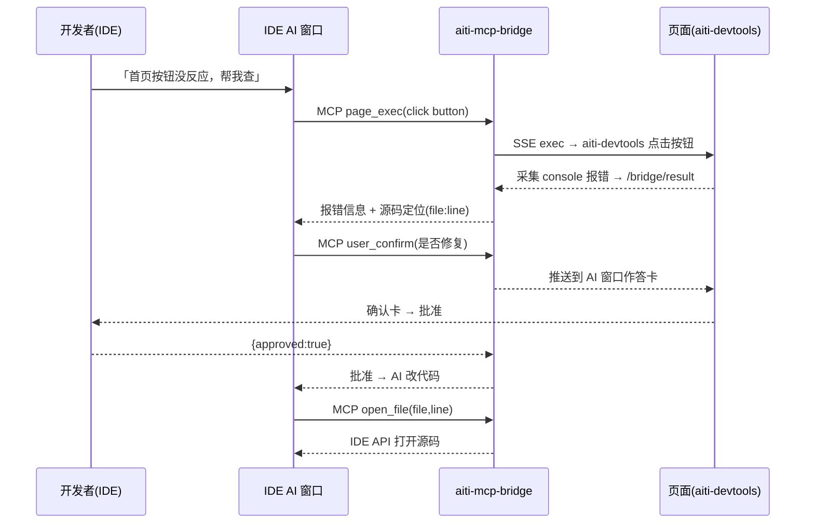

# 架构

## 1. 分层架构

```
┌─────────────────────────────────────────────────────────────┐
│ L4 入口层    aiti-agent (Web) · IDE 插件 · Chrome 扩展           │
├─────────────────────────────────────────────────────────────┤
│ L3 Agent 层 任意 AI agent（MCP client）                        │
├─────────────────────────────────────────────────────────────┤
│ L2 桥接层    aiti-mcp-bridge / aiti-mcp-server                 │
├─────────────────────────────────────────────────────────────┤
│ L1 注入层    aiti-devtools + vite/vue/next/react/svelte 插件    │
└─────────────────────────────────────────────────────────────┘
```

| 层 | 关键组件 | 职责 |
|---|---|---|
| L1 注入层 | `inject.js` / `aiti-devtools` client / Inspector UI / CDP 命令集 | 在页面内提供可执行、可采集、可交互的调试能力 |
| L2 桥接层 | bridge 服务 / MCP server / SSE / pageId 会话 | 把页面能力封装成 AI 可调用的 MCP 工具，并做会话路由 |
| L3 Agent 层 | 任意 MCP 客户端 | 消费 `page_*` / `user_*` 工具，完成 AI 推理 |
| L4 入口层 | aiti-agent / IDE 插件 | 用户操作面与注入编排 |

## 2. 注入链路（本地 inject）

```
工程插件（vite/vue/next/...） 或 IDE 插件代理 或 Chrome 扩展
        │ 注入（prepend / transformResponse 同语义）
        ▼
createAitiLauncher → window.__aiti 暴露
        │
        ├── 宿主自身注入（__AITI_POST__ 回调，source='self'）
        ├── 同源 iframe 注入（injectAllIframes + MutationObserver 兜底）
        └── 跨域 iframe 跳过（可枚举、不可定向执行）
        │
        ▼
消息信封：{ __aiti:1, type:'aiti_*', payload, requestId, _f:frameId }
```

- 宿主 → iframe：`postMessage({__aiti:1, _f:frameId, ...}, '*')`
- iframe → 宿主：`parent.postMessage`，宿主按 `e.source` 识别来源
- 异步命令：`execInPage(cmd, args, frameId)` → `requestId` 入 pending → 结果回 `aiti_exec_result{requestId,...}` resolve

## 3. 桥链路（MCP ⇄ 页面）

```
AI (MCP client)
  │ JSON-RPC (stdio / HTTP stateless / Streamable HTTP)
  ▼
bridge: /mcp/mcp ── tools/list · tools/call(page_exec/page_snapshot/user_*/aiti_inbox)
  │ SSE 推 {type:'exec', requestId, cmd, args}
  ▼
页面 client（mcpConnect 注册，EventSource 长连）
  │ post({type:'aiti_mcp_exec'})
  ▼
宿主 handleAiCommand → 危险命令确认 → execInPage 路由到 frameId
  │ aiti_exec_result → POST /bridge/result {pageId, requestId, ok, result}
  ▼
bridge 全局 pendingRequests resolve → MCP 响应回 AI
```

- **Streamable HTTP**（2026-08）：`GET /mcp/mcp` 持久流 + `Mcp-Session-Id`——服务端可主动写消息（sampling 请求/进度）；pi 等现代 client 自动优先探测（详情见 [MCP Server](/guide/mcp/server.md)）。
- **消息主通道 `aiti_inbox`**（2026-08）：人发消息/异步作答/页面事件进 outbox 队列，agent 调工具取走（任何 agent 100% 可用；sampling 推仅 pi 等少数支持，见 [接入 AI agent](/guide/mcp/ai-agents.md)）。
- **人侧界面 cockpit**（2026-08）：引导接入 + 地址配置中枢 + 操作台；无 aiUrl 时 AI 窗默认打开（见 [cockpit](/guide/mcp/cockpit.md)）。

事件方向：页面事件（`open_file`、`aiti_element_selected`、`user_*` 作答）→ bridge 广播 → AI 窗口（cockpit / IDE AI 窗口）展示与作答。

## 4. 会话模型（pageId）

```
pageId = instanceId/frameId
  instanceId：连接身份（带端口页面优先用端口号如 6513；否则随机 2字母+3数字 如 qx482）
  frameId：  目标 frame（'host' / 'f0' / 'f1'…）
```

- 页面连桥：申请 `instanceId` → 登记各 `frameId` → 拼装 `pageId`，**AI 只用一个词 `pageId`**
- 页面把 `instanceId` + `secret` 持久化到 localStorage → **reload 复用旧 id，不断线**
- 桥侧 TTL（默认 10 分钟）保留注册表；secret 不匹配或冲突才生成新 id
- AI 经 `GET /bridge/sessions` 发现全部可操作 pageId

## 5. 端到端数据流（IDE 修 bug 场景）



## 6. aiti-agent 侧架构

```
浏览器（主操作面；pi CLI / IDE 扩展经同一 agent 目录共享会话）
  │
  ▼
aiti-agent (Next.js, 基于 pi-web)
  ├── 会话管理（共享 pi JSONL + queue 持久化）
  ├── service-tunnels（HTTP vhost + TCP 隧道 + TOTP）
  ├── pi agent SDK（进程内执行层）
  ├── 调试可视化（M2: CDP / M3: noVNC / M1: ttyd）
  └── 工具市场（just get: mise → apt → npx/pipx）
```

> 相关：[产品矩阵](/products/README.md) · [MCP 桥 · 会话](/guide/mcp/session.md) · [开发者工具 · 注入原理](/devtools/inject.md)
