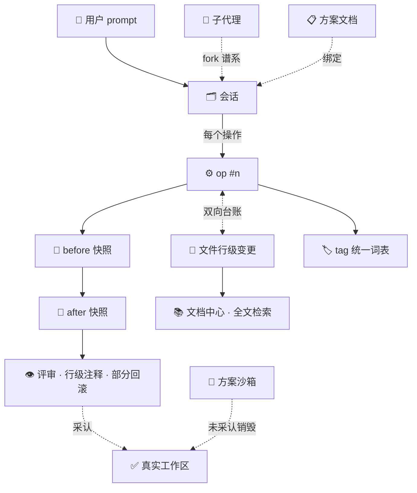

# 开发血缘 · Development Lineage

> ❝ git 记住每一次改动**的内容**，血缘记住每一次改动的**因果**。 ❞

## 30 秒版本

AI 改完代码，git 里只剩一个 commit。它不知道：

- 这行代码是**哪条 AI 会话**、受**哪句 prompt** 驱使改的；
- 当时依据的是**哪份方案文档**，那份方案现在还作不作数；
- 那句 prompt 后来有没有被**回撤**？改动里哪些被**采认**进工作区、哪些被**丢弃**？

aiti 的**开发血缘体系**把这条断链焊上：AI 的每个文件操作（op）都在一个独立追踪仓里留下 before / after 双快照，并与消息、会话、方案、文档、标签双向关联——任何一行代码都能回答五个问题：

> **谁改的？什么时候？为什么？怎么改的？现在还作数吗？**

一句话：**git 是内容史，血缘是因果史。**

---

## 为什么叫「血缘」

这套东西在业界有一族相邻概念，各有侧重，也各有盲区：

| 概念 | 领域 | 它回答什么 | 它缺什么 |
|---|---|---|---|
| **Git** | 版本控制 | 每次提交改了什么 | **为什么改**（commit message 是自由文本）；未提交的工作区现场无从归因；prompt 回撤后的中间状态没交代 |
| **Data Lineage** (Atlas / DataHub / OpenLineage) | 数据工程 | 数据从哪来、流经哪、上游错了影响谁 | 只管**数据管道**的表与字段，不管开发活动 |
| **Provenance 溯源** (W3C PROV) | 学术 / 档案学 | 实体被什么活动、什么主体产生 | 有形式模型、无工程落地——开发工具界几乎没人真实现 |
| **需求追溯矩阵 RTM** | 传统工程 | 需求 ↔ 设计 ↔ 代码 ↔ 测试 | 手工维护，AI 时代瞬间失效 |
| **Audit Trail 审计追踪** | 安全合规 | 谁何时干了什么 | 只记流水**不留现场**，不能行级回看、不能回滚 |
| **Time-travel 调试** | 调试器（rr 等） | 进程执行的每一步 | 进程级录制，不是开发活动级 |

aiti 的取位很明确：

> **用 data lineage 的「图」形态 + W3C PROV 的「因果」语义 + git 的「快照」基建，落到 AI 开发活动上。**

中文叫**血缘**而不是「溯源」，是因为「溯源」偏单点回查（顺一条链往回找），而「血缘」天然是**图谱**——我们体系里全是图：文件 ⇄ 消息 ⇄ 会话 ⇄ 方案 ⇄ 标签是多对多的网；fork 与子代理是家谱树；文档互链是一张算 PageRank 的引用图。

### AI 时代为什么非做不可

传统开发里 commit message 凑合能用（人写代码时顺手写两句）。AI 开发把断链问题放大成了常态：

1. **prompt 才是变更动因**——但它只存在于会话记录里，git 永远看不见；
2. **一句话可以派生一支子代理舰队**，一次改动的「作者」是一群 fork 出来的 agent，git 只认得最终那行 diff；
3. **方案文档与代码会漂移**——改了 800 行代码、方案一个字没动，没有任何工具会提醒你；
4. **「回撤重发」是高频动作**——撤回一条 prompt 后，文件系统里留下的中间变更若无交代，工作区就是薛定谔的。

---

## 五维模型

血缘体系由五个维度拼成，每一维回答一个不同的问题，各自有落地组件：

| 维度 | 回答的问题 | 承载组件 |
|---|---|---|
| 🗂 **会话维** | 谁干的？哪条会话？fork 自哪？ | All Sessions 面板 · 子代理 · tag 统一词表 |
| ⚙️ **操作维** | 具体改了什么？行级现场在哪？ | aiti-git-trace 编外追踪仓 |
| 📋 **意图维** | 为什么改？方案怎么说的？还作数吗？ | 方案先行（plan-first） |
| 📚 **知识维** | 关联哪些文档？怎么归组检索？ | 文档中心（doc-center） |
| ✅ **准入维** | 哪些算数？怎么反悔？ | 方案沙箱 · 代码评审 · 回撤三选项 |

### 🗂 会话维：会话是一等公民

- **All Sessions 面板**：pi / Claude Code / Codex / Qoder / 任意 ACP agent 同堂管理；历史会话不是化石，点一下复活。会话上挂的 tag 树就是**全系统统一的 tag 词表**——AI 打标、文档继承、界面补全都以它为准。
- **子代理谱系**：子代理不是黑盒进程，而是 fork 出的完整落盘会话，`parentSession` 头标明父子关系；追踪仓同步记 `parent/forkFrom` 链，`/lineage` 聚合端点能按祖先根优先 + BFS + 代际把整棵家谱拼出来，时间线第三个 tab 直接树状渲染。
- **tag 词表**：嵌套 tag（`项目A/模块B`）横向归组一切——会话、文档、方案共用一套词表，这是血缘图的「列索引」。
- **⚠ 追踪边界**：op 台账/追踪仓仅覆盖 **pi 运行时会话**（tool_call 拦截所在处）。All Sessions 同堂管理的外部 agent（Claude Code / Codex / Qoder / ACP 桥接会话）**不在追踪范围内**——它们出现在会话维与家谱，但不产生操作维的 op 行。

### ⚙️ 操作维：op 是原子单位

aiti-git-trace 给每个会话建一个**编外追踪仓**（`.aiti-trace`，一个独立完整的 git 库）：

- AI 每个会改文件的操作（op）执行**前、后各打一个带操作编号的 commit**——不只是流水账，是完整现场快照；
- 台账把 **文件 ⇄ op ⇄ 消息 ⇄ 会话** 双向焊死：可以从一行代码顺藤摸到那句 prompt，也可以从一条消息列出它动过的每个文件；
- **时间线三视图**：按消息看、按文件看、按家谱树看；
- 人在 cwd 之外改的文件（重定向到 $HOME、编辑器绝对路径……）由**关注路径模型**纳管，未纳管的变更也有 leak 记账（记录不拦截）。

### 📋 意图维：方案先行

- 会话 ↔ 方案文档显式**绑定**：md 变更出现时自动弹绑定向导，也能一键 `@文件`；
- 方案文档自带**生命周期 tag**：`方案/评审中` → `方案/已实施` → `方案/已过时`，由 AI 按约定写进 front-matter（**约定式**：无强制校验，违例靠自检/人工纠正）；
- **漂移感知**：代码大改而方案没跟 → 主动提醒「更新方案文档」；进入任何一条会话都先查一遍血缘台账——中途接手、终端里跑的、错过事件的会话也能补上绑定。

意图维是「反向链」：从代码回到需求。RTM 靠人填表，这里靠事件自动长出来。

### 📚 知识维：文档中心

- 文档与会话的关联直接消费操作维的台账：**「这份文档是哪些会话写的」一查便知**，反之亦然；
- **tag 六来源两层**：front-matter、正文 inline `#tag`（Obsidian 兼容）、路径派生、手动写回为静态层；方案绑定与会话标签继承为动态层（内存 join，不入库）——**不写 tag 也能被整理好**；
- md 互链 / `[[wiki]]` / `@路径` 构成**引用图**，算文档级 PageRank 融入搜索排序；node:sqlite FTS5 trigram 中文全文检索。

### ✅ 准入维：算数与反悔

血缘不只记录，还回答「哪些算数」：

- **方案沙箱**：plan 模式不再捆住 AI 的手，而是换掉它脚下的地板——一切实验发生在可丢弃快照里，结束后 AI 必须用硬协议 `declare_deliverables` 声明交付物，用户逐文件采认，**未采认内容随快照销毁**（删除必须逐项显式确认）；
- **回撤三选项**：回撤一条 prompt 时，文件变更「回撤 / 保留 / 逐条挑选」由用户决定——且**回撤本身也被记录**（追加式历史，可以再反悔）；
- **评审与行级回滚**：评审器直接吃血缘数据——以 trace 为源打开任意 op 区间的 diff，Monaco 行锚自动重映射、AI 预审、行级注释，选中几行**一键部分回滚**（patch 式，写路径收敛到追踪仓单一写者，冲突有 safety commit + 三方合并兜底）。

---

## 一条真实链路（归因五问走读）

> 「`src/retry.ts` 第 42 行的指数退避，到底是谁写的？」

| 问题 | 血缘体系的回答 |
|---|---|
| **谁改的？** | 会话 `S-3f2a`（pi · 2026-09-12 14:32），fork 自 `S-1d09` 的子代理「retry-refactor」——家谱视图里是一棵树 |
| **为什么？** | 用户 prompt「把固定重试改成指数退避」；该会话绑定方案 `docs/retry-plan.md`，tag：`方案/已实施` |
| **怎么改的？** | op #47，before/after 双快照，diff 显示 ±6 行，含该行 |
| **现在还作数吗？** | 评审里该行有一条行级注释；未发生过回滚 → 现行有效 |
| **还关联什么？** | 同 tag `retry` 下还有 3 份文档、2 条会话；这份方案的每次更新都在文档时间线里 |

传统工具链里回答这五个问题要翻 git log、翻会话记录、翻方案目录、凭记忆拼图——血缘体系里是**五次点击**。

### 与 W3C PROV 对号入座

不是巧合，血缘体系的数据模型与 W3C PROV（溯源领域的事实标准形式模型）天然同构：

| W3C PROV | 血缘体系里 |
|---|---|
| Entity（实体） | 文件状态快照（before / after）、方案文档、沙箱交付物 |
| Activity（活动） | op（编号操作）、轮次、会话、fork |
| Agent（主体） | AI agent（模型 × 会话身份）、人类用户（prompt 作者） |
| wasGeneratedBy | after 快照 ← op |
| used | op → before 快照 |
| wasAssociatedWith | op → 会话 → agent |
| wasDerivedFrom | 文件新状态 ← prompt / 方案文档 |
| wasInvalidatedBy | 回滚（且回滚本身也是一条被记录的 op） |

区别在于：PROV 停留在论文与标准里，这里每一条关系都有**落盘的 git 对象和可点击的 UI**。

---

## 设计原则（敢讲创新的底气）

1. **零侵入**：追踪仓是独立 git 库，用户的 `status` / `stash` / `clean` / `gc` / 远端推送完全无感；两个存储互不感知。删除追踪目录 = 卸载追踪，所见即所得。
2. **append-only**：历史只追加。回撤、回滚本身也是被记录的 op——反悔有据可查，还可以「反悔的反悔」。
3. **AI 绕不过**：追踪器挂在**工具调用层**（tool_call 先于执行、可拦截），不依赖 AI 自觉或 prompt 承诺——「所有的产出都是确定的」由机制保证，不靠口头约定。
4. **零轮询**：台账落行即事件（sink → traceBus → SSE / onOp），全链路推-听架构，常态零扫描。
5. **用户主权**：回不回撤、回撤哪些，永远由用户决定；沙箱未采认即销毁，删除逐项确认。
6. **消费复用**：评审器直接吃血缘数据（不另造 diff 轮子）；文档中心、消息智能、方案先行全部订阅同一条事件流——一套血缘，全家受益。

## 边界（不吹过头）

- **不追人手的每次按键**：手工编辑会在下一个 op 的 before 快照里被顺带捕获，作为「op 前现场」存在。
- **纯本地**：追踪仓不上传、不推送；定位为过程资产而非异地备份。
- **防误伤，不防对抗**：威胁模型是「手滑的强者同事」，不是恶意攻击者——不做 security theater。
- **无 git 目录也能追**：预算内自动建仓（全域追踪）；cwd 之外的变更走关注路径与 leak 记账，记录不拦截。

---

## 组件地图

| 维度 | 组件 | 一句话角色 | 深入阅读 |
|---|---|---|---|
| 会话维 | [All Sessions](/extensions/session-manager.md) | 多 agent 同堂 + tag 统一词表 | 扩展页 |
| 会话维 | [子代理](/extensions/aiti-subagents.md) | 子代理 = fork 会话，parentSession 谱系 | 扩展页 |
| 操作维 | aiti-git-trace | 编外追踪仓、op 台账、家谱 `/lineage` | `dev-repo/docs/aiti-git-trace-plan.md` |
| 意图维 | [方案先行](/extensions/aiti-plan-first.md) | 方案绑定、生命周期 tag、漂移提醒 | 扩展页 |
| 知识维 | aiti-doc-center | tag 六来源、文档⇄会话、PageRank、FTS | `dev-repo/docs/aiti-doc-center-plan.md` |
| 准入维 | plan-sandbox | 可丢弃快照、交付物硬协议采认 | `dev-repo/docs/pi-plan-sandbox-final-design.md` |
| 准入维 | [代码评审](/extensions/aiti-git-review.md) | trace 源评审、行级部分回滚 | 扩展页 |
| 同构实例 | [配置安全网](/extensions/aiti-configs.md) | 配置域的同款版本化与回滚 | 扩展页 |

## 展望

血缘的当前形态覆盖单机、单仓、开发期。往后走的方向（拍脑袋不算承诺）：

- **跨仓血缘图**：多个项目、多个 workspace 的血缘汇总成一张全局图；
- **血缘查询**：「列出所有大改未跟方案的日子」「这个 tag 下所有被回滚过的 op」；
- **标准导出**：PROV-N / JSON-LD 序列化，对接企业数据治理与合规审计；
- **团队级血缘**：会话与方案跨成员共享，新人入职先读「这段代码的血缘史」。

---

> 相关阅读：[什么是 aiti](/guide/what-is-aiti.md) · [架构](/guide/architecture.md) · [代码评审](/extensions/aiti-git-review.md) · [方案先行](/extensions/aiti-plan-first.md)
>
> 📌 实现状态：本页是五维血缘的**愿景全景**。各项承诺的落地进度、已知缺口与收敛计划（git-trace ⇄ plan-sandbox 同质化、采认入账、跨维导航等）见 `dev-repo/docs/aiti-lineage-closure-plan.md`（开发血缘实现差距深审与优化方案）。
