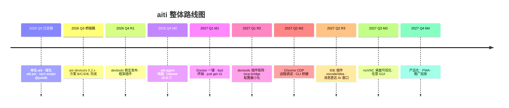

# aiti 整体规划（Master Plan）

> **活文档**：本文是 aiti 生态的唯一总纲，持续更新。每完成一步，更新对应状态标记（✅ 完成 / 🚧 进行中 / 📋 待定）。
> 一句话：**以 pi 为引擎，构建「Web 工作台 + 本地注入 + MCP 桥接」三位一体的 AI 开发工具生态** ——
> 浏览器是唯一操作面（aiti-agent），主流开发工具本地注入（aiti-devtools），任意 AI agent 直达 IDE 窗口（aiti-mcp-bridge）。

---

## 0. 一页纸摘要

| 维度 | 结论 |
|---|---|
| 干什么 | 自己的 AI 开发工具生态：自托管工作台 + 页面调试注入 + AI agent 改造 |
| 地基 | 构建于开源项目 agegr/pi-web（全生态唯一 service-tunnels / queue 恢复） |
| 引擎 | pi（earendil-works/pi，85k★，每日发版，mise 管理） |
| 差异化 | 共享 JSONL 会话 + 真实工作区 + 服务隧道 + **AI 与页面/IDE 同场协作**（无人五层齐全） |
| 产品矩阵 | 14 个产品，覆盖入口/注入/桥接/Agent 四层（见 [产品矩阵](/products/README.md)） |
| 品牌 | aiti · 域名 `aiti.pw` · GitHub `aiti-ai` · npm scope `@justdb` |
| 北极星 | 自己日常可用 → 外部 10+ 活跃用户 → 5+ 外部贡献者 |
| 当前状态 | 命名已定（aiti）；aiti-devtools 0.2.x 已可用（自检 21/21）；桥链路已通；aiti-agent M0 待执行 |

---

## 1. 产品矩阵（一图流）

```
┌─────────────────────────────────────────────────────────────┐
│ L4 入口层  aiti-agent(Web+Docker) · devtools-vscode/idea      │
├─────────────────────────────────────────────────────────────┤
│ L3 Agent 层 Claude Code · Cursor · IDE AI · aiti-agent       │
├─────────────────────────────────────────────────────────────┤
│ L2 桥接层  aiti-mcp-bridge · aiti-mcp-server                  │
├─────────────────────────────────────────────────────────────┤
│ L1 注入层  aiti-devtools · vite/vue/next/react/svelte 插件    │
└─────────────────────────────────────────────────────────────┘
```

| 层 | 产品 | 现状 | 里程碑 |
|---|---|---|---|
| L1 | aiti-devtools（核心包） | ✅ 0.2.x 自检 21/21 | R1 稳定 + 发布 |
| L1 | devtools-vite/vue/next/react/svelte | 📋 | R2 |
| L2 | aiti-mcp-bridge / server | 🚧 桥链路已通 | R2 配置最小化收官 |
| L3 | 任意 AI agent 接入 | ✅ 协议就绪 | 持续 |
| L4 | aiti-agent（基于 pi-web） | 📋 M0 | M0-M4 |
| L4 | devtools-vscode / idea | 📋 | R3 |

---

## 2. 目标与原则

### 2.1 三条主线

1. **主线 A · aiti-agent**：以 pi 为引擎的自托管 Web 工作台 —— 浏览器唯一操作面、Docker 一键起、远程调试可视化。
2. **主线 B · aiti-devtools**：嵌入各主流开发工具（Vite/Vue/Next/React/Svelte）、**本地 inject**、AI 与页面同场协作。
3. **主线 C · aiti-mcp-bridge**：配置 aiti-devtools 使用、**改造 AI agent**、支持 aiti-devtools 与 vscode/idea 插件完成注入、**消息直达 IDE 的 AI agent 窗口**。

### 2.2 原则

- **先产品后推广**：功能补齐前不投放；北极星指标是自己先用起来。
- **同一份注入脚本，三种形态复用**：主动适配 / Chrome 扩展 / IDE 插件，桥协议一致。
- **配置最小化**：AI 只告诉一个 `pageId`，其余全部自动（ID 生命周期页面侧掌控）。
- **安全默认关**：调试组件默认关闭，显式开启 + TOTP + 非 root + 白名单。

---

## 3. 里程碑路线图



### 主线 B/C 里程碑（注入 + 桥）

| 阶段 | 目标 | 交付 | 状态 |
|---|---|---|---|
| **R0 · 协议** | 注入/桥/会话协议打通 | 方案 B/C/D/E ✅；aiti-devtools 0.2.x（21 项自检）；桥端点全量 | ✅ |
| **R1 · 核心可用** | 开发者开箱即用 | `@justdb/aiti-devtools` 正式发布；README/demo 完善；`AITI_*` 环境变量统一 | 🚧 |
| **R2 · 插件矩阵** | 嵌入主流开发工具 | devtools-vite/vue/next/react/svelte；mcp-bridge 配置最小化收官；Chrome 扩展 | 📋 |
| **R3 · IDE 插件** | 消息直达 IDE AI 窗口 | devtools-vscode / devtools-idea（注入 + 桥 + AI 窗口面板 + 作答卡） | 📋 |
| **R4 · 平台化** | 生态开放 | 扩展市场（npm + MCP registry 数据源）、公开协议文档、贡献指南 | 📋 |

### 主线 A 里程碑（Web 工作台）

| 阶段 | 目标 | 交付 | 状态 |
|---|---|---|---|
| **M0 · 地基** | 稳定核心 + 独立身份 | ① 命名/品牌 ✅ ② rebase v0.8.7 ③ 验证链 ④ service-tunnels 公开化 | 📋 |
| **M1 · 工作台起步** | 远程能干活 | Docker（lite）+ `just get` v1 + ttyd 终端 + **WS 链路实测** | 📋 |
| **M2 · 浏览器调试** | 远程调 Chrome | CDP 9222 暴露 + DevTools + cdp 工具 + sessiond 评估 | 📋 |
| **M2.5 · CLI 桥接**（支线） | 任意 AI CLI 进 Web | lib/cli/ 适配层（Claude Code live / Codex·OpenCode turn-based） | 📋 |
| **M3 · 桌面可视化** | 远程看/操作 GUI | noVNC 桌面（full 镜像）+ 任意 GUI + TOTP 编排 | 📋 |
| **M4 · 产品化** | 有人愿意用 | 编辑器、PWA/移动端、SSH 多机、推广投放 | 📋 |
| **生态期** | 有社区 | 外部 PR、addons、引擎抽象（pi/omp 双引擎评估） | 📋 |

---

## 4. 关键决策记录（ADR 摘要）

| # | 决策 | 结论 | 依据 |
|---|---|---|---|
| D1 | 上游不合并 PR 怎么办 | 持续同步上游起步，每周 rebase | 先保可用，再谈独立 |
| D2 | jmfederico 是竞品不是续作 | 不能合并其代码，只能借鉴功能 | fork:false、栈不同、品牌混淆 |
| D3 | 生态碎片化 → 抢事实主线？ | 不做主线之争，功能做好自己 | 成本高收益不确定 |
| D4 | 产品定位升维 | 从"跟随上游"到"自己的开发工具" | 用户明确：独立品牌/独立边界 |
| D5 | 远程调试功能集 | CDP/VNC/ttyd 三件套；WS 链路 M1 首验 | 对照 PiClaw 已验证；service-tunnels 零改动可暴露 |
| D6 | 工具市场形态 | `just get <tool>` 统一安装（mise → apt → npx/pipx） | just 35k★ / mise 32k★ |
| D7 | 推广时机 | 先产品后推广（M1 后再投放） | 缺终端/Docker 时转化率低 |
| D8 | omp（Oh My Pi） | 主线绑 pi；M0 验证 @oh-my-pi SDK 兼容性；M4 双引擎备选 | omp 22.5k★、会话格式不兼容、无成熟 Web UI |
| D9 | devtools 目标路由 | 方案 C（宿主目标路由）替代方案 B：目标 = 宿主 + 宿主真实 iframe | inject 不建自建 targetFrame |
| D10 | MCP 会话命名 | `token → instanceId`、`uid → frameId`、组合 `pageId` | 职责清晰、配置最小化 |
| D11 | 用户交互协议 | `user_*` 工具族独立成类（confirm/choose/input/pick/presence/notify） | 工具名即语义，返回形状不同 |
| D12 | npm scope | `@justdb/*`（裸名 3-4 字母被 npm 防抢注风控拒绝） | 实测 404/拒绝 |
| D13 | 域名 | `aiti.pw` 主站点（官网/文档/端点） | 2026-08-08 申请 |

---

## 5. 现状盘点（2026 Q3）

### 已完成 ✅

- **品牌身份**：命名 aiti、域名 aiti.pw、GitHub 组织 aiti-ai、npm scope @justdb
- **aiti-devtools 0.2.x**：自检 21/21 全过（原生 HTML + React 均验证）；Inspector/HUD/事件冻结/调速面板/类 CDP 42 命令/框架识别/MCP 桥/刷新恢复/安全边界
- **方案 B/C/D/E**：宿主目标路由、MCP 桥会话体系（pageId）、用户交互工具族（user_*）全链路实施
- **桥链路**：SSE 页面桥 + 全局 pendingRequests + 事件广播（open_file）；service-tunnels 集成注入（transformResponse prepend）
- **调研**：pi-web 生态全景、上游谱系、omp、CLI 交互、工具市场、推广方案

### 进行中 🚧

- aiti-devtools 正式发布（0.2.x → 1.0 前稳定）
- `AITI_*` 环境变量统一收口（DBG_* → AITI_*）
- aiti-agent M0（rebase + 验证链）

### 待定 📋

- devtools 框架插件矩阵（vite/vue/next/react/svelte）
- IDE 插件（vscode/idea）
- aiti-agent M1-M4
- 扩展市场 / 公开协议文档

---

## 6. 风险与对策

| 风险 | 对策 | 状态 |
|---|---|---|
| WS 链路（M1 首验） | Next16 proxy rewrite 实测；不通则 TCP 隧道 | 📋 |
| pi 每日发版 API 漂移 | CI 自动升级 + mise 版本锁定 | 📋 |
| 镜像体积 1-2GB | 多阶段 + lite/full 双 tag | 📋 |
| 安全面（VNC/CDP/终端/注入） | 默认关 + TOTP + 非 root + 白名单 + 手势桥 | ✅ 已设计 |
| 个人维护负荷 | 功能按"自己是否用"取舍；CI 自动化 | 📋 |
| CDP 工具 token 消耗 | 可选 skill，默认不加载 | 📋 |
| 与 PiClaw 竞争 | 拼定位不拼功能（共享会话 + 真实工作区 + 隧道） | ✅ 已定 |
| 引擎绑定（pi vs omp） | 主线绑 pi；M0 验证 SDK 兼容；M4 评估双引擎 | 📋 |
| IDE AI 窗口扩展点变化 | 面板回退方案（ai.html）兜底 | 📋 |

---

## 7. 待办清单

- [ ] **aiti-devtools 1.0 前稳定**：0.2.x 发布打磨、`AITI_*` 收口、自检扩展（21 → 30+）
- [ ] **devtools 插件矩阵**：vite 优先（R2），vue/next/react/svelte 跟进
- [ ] **aiti-mcp-bridge 配置最小化收官**：claim/secret/TTL 全量验证；sessions 发现文档化
- [ ] **aiti-agent M0**：rebase v0.8.7、验证链、service-tunnels 公开化
- [ ] **IDE 插件（R3）**：vscode 先行（注入 + 桥 + Copilot Chat 面板），idea 跟进
- [ ] **域名/托管**：aiti.pw 解析生效后配置站点（海外托管免备案）
- [ ] **npm 清理**：`npm unpublish @justdb/aiti@0.0.0`（占坑脏版本，文档复制完成后执行）
- [ ] **GitHub 建仓库**：aiti-ai/aiti、aiti-ai/aiti-docs、aiti-ai/aiti-devtools 等
- [ ] **CLI 桥接 P0 前置实测**：CC control_request、Codex exec resume、OpenCode run --session
- [ ] **公开协议文档**：桥协议、pageId 会话、注入脚本规范 → 生态开放（R4）

---

## 8. 文档索引

| 文档 | 内容 |
|---|---|
| **本文** | 整体规划总纲 |
| [产品矩阵](/products/README.md) | 14 个产品全景 |
| [aiti-agent 规划](/roadmaps/aiti-agent.md) | Web 工作台阶段计划 |
| [aiti-devtools 规划](/roadmaps/aiti-devtools.md) | 注入生态计划 |
| [aiti-mcp-bridge 规划](/roadmaps/aiti-mcp-bridge.md) | 桥接层计划 |
| [指南 · 架构](/guide/architecture.md) | 分层架构与数据流 |
| [MCP 桥 · 会话](/guide/mcp/session.md) | pageId 会话体系 |
