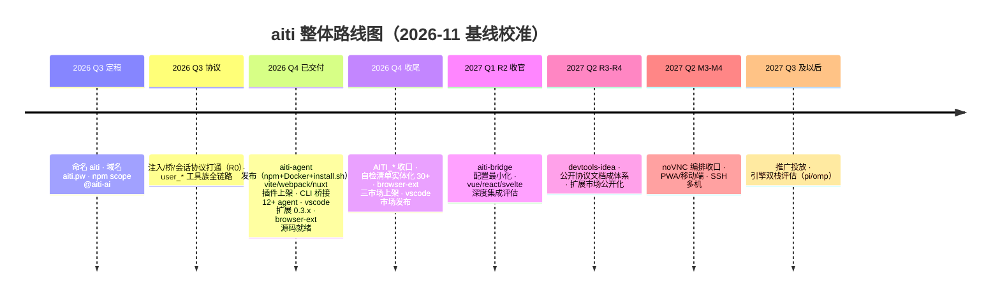

# aiti 整体规划（Master Plan）

> **活文档**：本文是 aiti 生态的唯一总纲，持续更新。每完成一步，更新对应状态标记（✅ 完成 / 🚧 进行中 / 📋 待定）。
> **现状基准**：逐产品的当前状态以[产品矩阵](/products/README.md)为唯一事实源；本页与各路线图只描述计划、里程碑与验收标准。
> 一句话：**以 pi 为引擎，构建「Web 工作台 + 本地注入 + MCP 桥接」三位一体的 AI 开发工具生态** ——
> Web 工作台为主操作面、与 pi CLI / IDE 扩展同源兼容（aiti-agent），主流开发工具本地注入（aiti-devtools），任意 AI agent 直达 IDE 窗口（aiti-bridge）。

---

## 0. 一页纸摘要

| 维度 | 结论 |
|---|---|
| 干什么 | 自己的 AI 开发工具生态：自托管工作台 + 页面调试注入 + AI agent 改造 |
| 地基 | 开源项目 agegr/pi-web 为上游底座，service-tunnels、queue 崩溃恢复等自研能力叠加其上 |
| 引擎 | pi（earendil-works/pi，122k★，每日发版，mise 管理） |
| 差异化 | 共享 JSONL 会话 + 真实工作区 + 服务隧道 + **AI 与页面/IDE 同场协作**（无人五层齐全） |
| 产品矩阵 | 14 个产品，覆盖入口/注入/桥接/Agent 四层（见 [产品矩阵](/products/README.md)） |
| 品牌 | aiti · 域名 `aiti.pw`（已上线） · GitHub `aiti-ai` · npm scope `@aiti-ai` |
| 北极星 | 自己日常可用 → 外部 10+ 活跃用户 → 5+ 外部贡献者 |
| 当前状态（2026-11） | aiti-agent 0.15.x 已发布（npm + Docker core/full + install.sh）；载体插件 vite/webpack/nuxt 已上架；aiti-bridge 0.2.x 已上架；vscode 扩展 0.3.x 与 browser-ext 源码就绪待上架；CLI 桥接 12+ agent；R1 收尾中 |

---

## 1. 产品矩阵（一图流）

```
┌──────────────────────────────────────────────────────────────────┐
│ L4 入口层  aiti-agent(Web+Docker) · devtools-vscode/idea · browser-ext │
├──────────────────────────────────────────────────────────────────┤
│ L3 Agent 层 12 家 CLI 适配 · Claude Code · Cursor · IDE AI · aiti-agent │
├──────────────────────────────────────────────────────────────────┤
│ L2 桥接层  aiti-bridge（MCP 端点内置 + stdio⇄HTTP shim）           │
├──────────────────────────────────────────────────────────────────┤
│ L1 注入层  aiti-devtools · vite/webpack/nuxt 载体插件             │
└──────────────────────────────────────────────────────────────────┘
```

| 层 | 产品 | 现状 | 里程碑 |
|---|---|---|---|
| L1 | aiti-devtools（注入 SDK，随 pi-web 内置 + 载体插件分发） | ✅ | — |
| L1 | 载体插件 vite / webpack / nuxt | ✅ 0.1.x 已上架 npm | R2 收官（vue/react/svelte 深度集成评估） |
| L1 | browser-ext（Chrome 扩展，形态②免改代码注入） | 🚧 源码就绪（商店素材/发布手册齐备） | R2 三市场上架 |
| L2 | aiti-bridge / server | ✅ 0.2.x 已上架 npm | R1 配置最小化收官 |
| L3 | 任意 AI agent 接入 | ✅ 12 家 CLI 适配 + [接入文档](/guide/mcp/ai-agents.md) | 持续 |
| L4 | aiti-agent（基于 pi-web） | ✅ 0.15.x（npm + Docker + install.sh） | M3/M4 收尾 |
| L4 | devtools-vscode | 🚧 0.3.x 源码就绪（市场未发布） | R3 市场发布 |
| L4 | devtools-idea | 📋 | R3 |

---

## 2. 目标与原则

### 2.1 三条主线

1. **主线 A · aiti-agent**：以 pi 为引擎的自托管 Web 工作台 —— 浏览器主操作面（兼容 pi CLI / IDE 扩展）、Docker 一键起、远程调试可视化。
2. **主线 B · aiti-devtools**：嵌入各主流开发工具（Vite/Webpack/Nuxt…）、**本地 inject**、AI 与页面同场协作。
3. **主线 C · aiti-bridge**：配置 aiti-devtools 使用、**改造 AI agent**、支持 aiti-devtools 与 vscode/idea 插件完成注入、**消息直达 IDE 的 AI agent 窗口**。

### 2.2 原则

- **先产品后推广**：功能补齐前不投放；北极星指标是自己先用起来。
- **同一份注入脚本，三种形态复用**：主动适配 / Chrome 扩展 / IDE 插件，桥协议一致。
- **配置最小化**：AI 只告诉一个 `pageId`，其余全部自动（ID 生命周期页面侧掌控）。
- **安全默认关**：调试组件默认关闭，显式开启 + TOTP + 非 root + 白名单。

---

## 3. 里程碑路线图



### 主线 B/C 里程碑（注入 + 桥）

| 阶段 | 目标 | 交付 | 状态 |
|---|---|---|---|
| **R0 · 协议** | 注入/桥/会话协议打通 | 注入脚本 + MCP 桥 + pageId 会话体系 + user_* 交互工具族全链路；桥端点全量 | ✅ |
| **R1 · 核心可用** | 开发者开箱即用 | npm 包矩阵已上架（core / inject / vite / webpack / nuxt / bridge）；剩 `AITI_*` 收口、自检清单实体化 30+、README/demo 打磨 | 🚧 |
| **R2 · 插件矩阵** | 嵌入主流开发工具 | vite/webpack/nuxt ✅ 已上架；browser-ext 🚧 待上架；vue/react/svelte 现阶段复用 Vite 插件（深度集成 📋）；aiti-bridge 配置最小化收官 | 🚧 |
| **R3 · IDE 插件** | 消息直达 IDE AI 窗口 | vscode 0.3.x 源码就绪（注入 + 桥 + MCP 接线 + AI 窗口跳转）；idea 📋 | 🚧 |
| **R4 · 平台化** | 生态开放 | 扩展市场（npm + MCP registry 数据源）、公开协议文档成体系、贡献指南 | 📋 |

### 主线 A 里程碑（Web 工作台）

| 阶段 | 目标 | 交付 | 状态 |
|---|---|---|---|
| **M0 · 地基** | 稳定核心 + 独立身份 | ① 命名/品牌 ✅ ② 上游跟进（原 rebase v0.8.7，已演进为常态化上游同步，现版 0.15.x） ③ CI 验证链 ✅ ④ service-tunnels 公开化 ✅（[GitHub 独立仓](https://github.com/aiti-ai/service-tunnels)） | ✅ |
| **M1 · 工作台起步** | 远程能干活 | Docker core/full 双镜像 ✅（超出 lite 规划）；终端以 aiti-cmd PTY 面板交付 ✅；WS 链路生产消解 ✅；`just get` 工具市场 📋 评估中 | 🚧 |
| **M2 · 浏览器调试** | 远程调 Chrome | CDP 已接入（chrome-devtools / msedge-cdp / remote-cdp MCP）；与 devtools `page_exec`（页面内轻量命令集）互补；sessiond 评估 📋 | ✅ 主干 |
| **M2.5 · CLI 桥接**（支线） | 任意 AI CLI 进 Web | 12 家 CLI 适配扩展（Claude Code / Codex / OpenCode / Cursor / ZCode / Qoder / CodeBuddy / OMP / ACP / 自定义 Agent…）+ [接入文档](/guide/mcp/ai-agents.md) | ✅ 超额交付 |
| **M3 · 桌面可视化** | 远程看/操作 GUI | computer-use MCP + VNC 契约已有；noVNC full 镜像编排 / TOTP 编排 📋 | 🚧 |
| **M4 · 产品化** | 有人愿意用 | 编辑器套件（aiti-editor / onlyoffice / univer / word）✅；PWA/移动端 📋；SSH 多机 📋；推广投放 📋 | 🚧 |
| **生态期** | 有社区 | 外部 PR、addons、引擎抽象（pi/omp 双引擎评估） | 📋 |

---

## 4. 关键决策记录（ADR 摘要）

| # | 决策 | 结论 | 依据 |
|---|---|---|---|
| D1 | 上游不合并 PR 怎么办 | 持续同步上游起步，每周 rebase | 先保可用，再谈独立 |
| D2 | jmfederico 是竞品不是续作 | 不能合并其代码，只能借鉴功能 | fork:false、栈不同、品牌混淆 |
| D3 | 生态碎片化 → 抢事实主线？ | 不做主线之争，功能做好自己 | 成本高收益不确定 |
| D4 | 产品定位升维 | 从"跟随上游"到"自己的开发工具" | 用户明确：独立品牌/独立边界 |
| D5 | 远程调试功能集 | CDP/VNC/终端三件套；WS 链路生产验证 | 对照 PiClaw 已验证；service-tunnels 零改动可暴露 |
| D6 | 工具市场形态 | `just get <tool>` 统一安装（mise → apt → npx/pipx） | just 35k★ / mise 32k★ |
| D7 | 推广时机 | 先产品后推广（M1 后再投放） | 缺终端/Docker 时转化率低 |
| D8 | omp（Oh My Pi） | 主线绑 pi；omp 会话级适配已有（aiti-omp-agent）；M4 双引擎深度评估 | omp 22.5k★、会话格式不兼容、无成熟 Web UI |
| D9 | devtools 目标路由 | 宿主目标路由替代自建 targetFrame：目标 = 宿主 + 宿主真实 iframe | inject 不建自建 targetFrame |
| D10 | MCP 会话命名 | `token → instanceId`、`uid → frameId`、组合 `pageId` | 职责清晰、配置最小化 |
| D11 | 用户交互协议 | `user_*` 工具族独立成类（confirm/choose/input/pick/presence/notify） | 工具名即语义，返回形状不同 |
| D12 | npm scope | `@aiti-ai/*`（裸名 3-4 字母被 npm 防抢注风控拒绝） | 实测 404/拒绝 |
| D13 | 域名 | `aiti.pw` 主站点（官网/文档/端点） | 2026-08-08 申请，已上线 |
| D14 | 仓结构：aiti-ai = 发布镜像仓兼宿主运行时 | dev/prod 同跑 aiti-ai 仓；开发在内部真源仓进行，经镜像单向同步进发布仓 | 单一真源；构建/发布/运行同链 |
| D15 | npm 公开发布链 | staging → 验证 → promote npmjs 三段式（publish-npm.yml）；主包 Release 与 Docker 发布带依赖守卫 fail-fast | 本地直发撞 2FA（EOTP）且无 provenance |
| D16 | 扩展生态公开化 | 内部真源仓唯一开发源；extensions/ 全量单向镜像到公开仓（脚本 + 巡检，发布仓侧禁手改） | npm 公开发布与 R4 生态开放的前提 |

---

## 5. 现状快照（2026-11）

> **逐产品状态的唯一事实源是[产品矩阵](/products/README.md)**，本节只保留阶段级摘要。

- **已交付 ✅**：aiti-agent 0.15.x（npm + Docker core/full + install.sh）；aiti-bridge 0.2.x；载体插件 vite/webpack/nuxt；CLI 桥接 12+ agent；CDP 调试通道；aiti.pw 文档站
- **收尾中 🚧**：`AITI_*` 环境变量收口（产品源码残留 22 处 DBG_）；自检清单实体化；vscode 扩展与 browser-ext 上架；bridge claim/secret/TTL 回归文档化
- **未启动 📋**：devtools-idea；vue/react/svelte 深度集成（现阶段复用 Vite 插件）；PWA/移动端；SSH 多机；推广投放；扩展市场公开化

---

## 6. 风险与对策

| 风险 | 对策 | 状态 |
|---|---|---|
| WS 链路 | 生产以 nginx + SSE 稳定运行；HMR websocket 走 nginx map | ✅ 基本消解 |
| pi 每日发版 API 漂移 | 常态化上游同步（rebase 节奏 + 检查脚本）；mise 版本锁定 | 🚧 |
| 镜像体积 | 多阶段构建 + core/full 双 tag | ✅ 已交付 |
| 安全面（VNC/CDP/终端/注入） | 默认关 + TOTP + 非 root + 白名单 + 手势桥 | ✅ 已设计 |
| 个人维护负荷 | 功能按"自己是否用"取舍；CI 自动化 | 🚧 |
| CDP 工具 token 消耗 | 可选 skill，默认不加载 | 📋 |
| 与 PiClaw 竞争 | 拼定位不拼功能（共享会话 + 真实工作区 + 隧道） | ✅ 已定 |
| 引擎绑定（pi vs omp） | 主线绑 pi；omp 会话适配已有；M4 评估双引擎 | 🚧 |
| IDE AI 窗口扩展点变化 | 面板回退方案（cockpit）兜底；vscode 扩展已实现跳转 | 🚧 兜底就绪 |

---

## 7. 待办清单

- [ ] **aiti-devtools 收尾**：`DBG_*` → `AITI_*`（源码残留 22 处）、自检清单实体化并扩展到 30+
- [ ] **browser-ext 三市场上架**：Chrome Web Store / Edge Add-ons / Firefox AMO（素材与发布手册已就位）
- [ ] **vscode 扩展市场发布**：VS Code Marketplace + Open VSX
- [ ] **aiti-bridge 配置最小化收官**：claim/secret/TTL 全量验证；sessions 发现文档化
- [ ] **公开协议文档成体系**：桥协议、pageId 会话、注入脚本规范 → 生态开放（R4）
- [ ] **vue/react/svelte 深度集成评估**（现阶段复用 Vite 插件）
- [ ] **devtools-idea 立项**（JetBrains）
- [ ] **`just get` 工具市场评估**（原 M1 规划项）
- [ ] **PWA / 移动端 / SSH 多机**
- [ ] **推广投放首战**（渠道与素材见 [aiti-agent 规划](/roadmaps/aiti-agent.md)）

---

## 8. 文档索引

| 文档 | 内容 |
|---|---|
| **本文** | 整体规划总纲 |
| [产品矩阵](/products/README.md) | 14 个产品全景（现状唯一事实源） |
| [aiti-agent 规划](/roadmaps/aiti-agent.md) | Web 工作台阶段计划 |
| [aiti-devtools 规划](/roadmaps/aiti-devtools.md) | 注入生态计划 |
| [aiti-bridge 规划](/roadmaps/aiti-bridge.md) | 桥接层计划 |
| [指南 · 架构](/guide/architecture.md) | 分层架构与数据流 |
| [MCP 桥 · 会话](/guide/mcp/session.md) | pageId 会话体系 |
